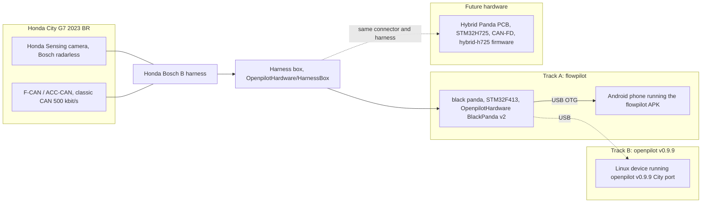

# openpilot for the Honda City G7 (2023, Brazil)

[Versao em portugues: README.pt-BR.md](README.pt-BR.md)

An end-to-end, open effort to run openpilot / flowpilot on a 7th generation Honda City
(2023, Brazilian market, Honda Sensing camera-only "Bosch radarless", classic CAN, Bosch B
harness) using black panda class hardware (STM32F413), together with a from-scratch
**Hybrid Panda** PCB design (STM32H725, CAN-FD capable, black panda form factor) intended
as future hardware. The repository collects the hardware design, the panda firmware trees,
the car ports for two software stacks, the flashing procedure and every audit and report
produced along the way.

Author: Bruno Costa ([kriptomad](https://github.com/kriptomad)). This project is not
affiliated with, endorsed by or supported by comma.ai, Honda or any of the upstream authors.

**Nothing in this repository has been validated on real hardware or in a car.** Every
status below describes static analysis, compilation or continuous-integration results only.
No board has been fabricated, no panda has been flashed, no car has been fingerprinted.

## Status at a glance

| Track | Where | Status (honest) |
|---|---|---|
| Hybrid Panda PCB (STM32H725ZGT6, 4 layers) | [hardware/hybrid-panda](hardware/hybrid-panda) | Design complete and software-verified (2026-10-29): DRC 0 clearance / 0 unconnected / 0 shorts / 0 parity, 73 remaining items all intentional `lib_footprint_mismatch`; ERC 0 errors; gerber-rebuilt connectivity 0 short / 0 open; independent pin-by-pin review against the panda firmware. **Not physically verified**; bare-PCB order at the owner's discretion. Nothing built. |
| panda firmware `revive-f4` (black panda on current panda master) | [firmware/panda-revive-f4](firmware/panda-revive-f4) (submodule) | Compiles (debug and release), MISRA clean, `test.sh` green on the fork. Never executed on a board. |
| panda firmware `hybrid-h725` (Hybrid Panda target) | [firmware/panda-hybrid-h725](firmware/panda-hybrid-h725) (submodule) | Compiles (`panda_h7`, `panda_h7_hybrid`, `panda_h7_ldo`), MISRA clean. Never executed on a board (no board exists). |
| openpilot v0.9.9 Honda City port | [software/openpilot-v0.9.9-city-g7](software/openpilot-v0.9.9-city-g7) + [software/opendbc-v0.9.9-city-g7](software/opendbc-v0.9.9-city-g7) (submodules) | Port complete, two independent audits, CI green on the fork (static, build, unit, cars 0-3; process replay differs only by the expected `carParams.flags` bit). Untested in a car. |
| flowpilot standalone APK | [software/flowpilot-city-g7](software/flowpilot-city-g7) (submodule) | APK builds in GitHub Actions. Boots on a Samsung Galaxy S24 Ultra up to "waiting for controls" without a panda. Untested with a panda or a car. |
| Flashing guides | [docs/flashing](docs/flashing) | Written from the code and the PCB files. Not executed on hardware. |

## Safety disclaimer

This is an unvalidated, hobbyist research project. openpilot is a driver-assistance system
that requires the driver's full attention at all times; the ports and hardware in this
repository have not gone through comma.ai's validation, nor any other.

- Do not install any of this on a car that will be driven on public roads before completing
  bench tests (panda enumeration, `health()`, CAN loopback), passive CAN capture in the car
  with the car stationary, fingerprint confirmation and parking-lot tests with the system
  disengaged, in that order. The checklists live in
  [docs/flashing/flash-black-panda-city-g7.md](docs/flashing/flash-black-panda-city-g7.md)
  section 7 and [hardware/research/step9-bringup-e-teste-veiculo.md](hardware/research/step9-bringup-e-teste-veiculo.md).
- The Hybrid Panda PCB has never been manufactured. Its fabrication package is kept for
  review only; see [hardware/fabrication/readme.md](hardware/fabrication/readme.md).
- The firmware binaries are signed with comma's public debug key. They are development
  builds, not releases.
- You are solely responsible for what you do with this material. Check your local laws.

## Architecture overview



- Track A (flowpilot): black panda flashed with the firmware built from the flowpilot tree
  (commaai/panda `abdc4185`), phone connected through USB OTG, flowpilot APK with the
  City G7 car layer. This is the path currently being prepared for first tests.
- Track B (openpilot v0.9.9): the last openpilot release that still supports the black panda
  natively, with the City G7 port backported from upstream opendbc, running on a Linux device.
- Future hardware: the Hybrid Panda PCB keeps the black panda form factor, connectors and
  harness, but carries an STM32H725 so the current red panda firmware (and its CAN-FD stack)
  can run on it. The City G7 is classic CAN, so this is not required for the car; it is a
  deliberate decision (D-05 in [docs/decisions.md](docs/decisions.md)).

## Repository map

| Path | Content |
|---|---|
| [README.md](README.md), [README.pt-BR.md](README.pt-BR.md) | This document and its Portuguese translation. |
| [LICENSE.md](LICENSE.md), [licenses/](licenses) | License inventory of every upstream source used, obligations, and the upstream license texts. |
| [docs/decisions.md](docs/decisions.md) | Decision log D-01 .. D-38 of the Hybrid Panda design (MCU choice, SMPS topology, straps, routing policy, deferred items). |
| [docs/final-report.md](docs/final-report.md) | Final report of the Hybrid Panda design protocol (STEP 1-9), premises P1-P11, risks, honesty lists. |
| [docs/final-audit.md](docs/final-audit.md) | Geometric final audit of the PCB (shorts, via-in-pad, hole hits, split nets). |
| [docs/progress.md](docs/progress.md) | Resume checkpoint of the design sessions (historical). |
| [docs/protocol-v3.md](docs/protocol-v3.md) | The working protocol the design followed (historical). |
| [docs/reference-sources.md](docs/reference-sources.md) | Upstream clones and pinned commits used as read-only references. |
| [docs/flashing/](docs/flashing) | Black panda flashing guide for the City G7 (EN and pt-BR). |
| [docs/hardware/](docs/hardware) | Hybrid Panda hardware documentation: retrofit description, BOM (`bom.md` + `bom.csv`), schematic description, PCB fabrication specification (EN and pt-BR). Design only; not fabricated. |
| [docs/legacy-index.md](docs/legacy-index.md) | Generated index of the development repository with the old paths, kept for traceability. |
| [hardware/hybrid-panda/](hardware/hybrid-panda) | KiCad project: `HybridPanda.kicad_pcb`, `.kicad_sch`, `.kicad_pro`, local footprints (`.pretty`), 3D models, symbols; `snapshots/` holds the baseline and STEP 5 copies of the board. |
| [hardware/fabrication/](hardware/fabrication) | Gerbers, drill, assembly (BOM/CPL for JLCPCB), PDFs, STEP model, JLC zip. **Do not fabricate** (see its readme). |
| [hardware/reports/](hardware/reports) | DRC/ERC JSON reports, netlists, BOM, SI/PI audit, footprint-vs-datasheet audit, BOM audit, correction campaign log (`correcoes-aplicadas.md`, `corrections/`). |
| [hardware/research/](hardware/research) | Engineering research: hardware requirements extracted from the firmware (`hrs-red-panda.md`), coverage matrix, pin tables, STEP 3-9 documents, firmware port report (`hybrid-fw-port.md`), pandarevive scope, renders. |
| [hardware/scripts/](hardware/scripts) | KiCad Python / kicad-cli automation used to build, route, correct, validate and export the board, plus the DRC gate (`corr_gate.py`). |
| [hardware/reference/datasheets/](hardware/reference/datasheets) | STM32H725 datasheet (DS13313) and its extracted text. |
| [firmware/](firmware) | panda firmware: two submodules (`panda-revive-f4`, `panda-hybrid-h725`) and prebuilt black panda binaries in `prebuilt/`. See [firmware/readme.md](firmware/readme.md). |
| [software/](software) | Three submodules (openpilot v0.9.9 port, opendbc v0.9.9 port, flowpilot) plus the port documentation, patch series, audit tools and Windows test shims. See [software/readme.md](software/readme.md). |
| [archive/](archive) | Original OpenBlackPanda KiCad project the Hybrid Panda derives from (`baseline-original/`) and the SHA-256 manifests of the development tree (`manifests/`). See [archive/readme.md](archive/readme.md). |

## Quick start per track

### A. Install the flowpilot APK

1. Download `flowpilot-city-g7-brazil-ffd228c.apk` from this repository's release
   [v0.1-city-g7-brazil](https://github.com/kriptomad/openpilot-honda-city-brasil/releases/tag/v0.1-city-g7-brazil)
   (mirror of the build published in
   [kriptomad/flowpilot-city-g7](https://github.com/kriptomad/flowpilot-city-g7/releases/tag/v0.1-city-g7-brazil)).
2. Verify the hash before installing:
   `SHA256 493891cd62d3f2eaf094e414489d7b0dae8bde297a673c305fba6eef298d4adb`
   (235,399,803 bytes).
3. Install with `adb install -r flowpilot-city-g7-brazil-ffd228c.apk` (or from the file
   manager with unknown sources allowed), disable battery optimisation for the app, grant
   camera, location and USB permissions.
4. In the app settings select the car `HONDA CITY 7G` (param `Mycar`). Details, device
   requirements and the list of what is not verified:
   [software/flowpilot-port/port-city-flowpilot.md](software/flowpilot-port/port-city-flowpilot.md)
   sections 8 to 10.

### B. Flash the black panda

Full guide: [docs/flashing/flash-black-panda-city-g7.md](docs/flashing/flash-black-panda-city-g7.md)
([pt-BR](docs/flashing/flash-black-panda-city-g7.pt-br.md)). Summary for the flowpilot track:

1. Hardware: Loetkolben OpenpilotHardware BlackPanda v2 (STM32F413RGT6). `SW1` pulls
   `BOOT0` high: hold it while plugging the USB-C cable to enter the ST DFU bootloader
   (`0483:df11`). On Windows bind WinUSB with Zadig for `0483:df11`, `bbaa:ddee` and
   `bbaa:ddcc`.
2. Python side: `pip install libusb1 pyusb` and run from the flowpilot tree
   ([software/flowpilot-city-g7](software/flowpilot-city-g7)), so that the `panda` package
   matches the firmware.
3. Write the bootstub: `python -c "from panda import PandaDFU; PandaDFU(None).recover()"`.
   The board re-enumerates as `bbaa:ddee`.
4. Write the application:
   `python -c "from panda import Panda; Panda().flash(fn=r'firmware/prebuilt/flowpilot-black-panda/panda.bin.signed')"`
   (path relative to this repository). The board re-enumerates as `bbaa:ddcc`.
5. Check: `python -c "from panda import Panda; p=Panda(); print(p.get_type(), p.get_version())"`
   should print `b'\x03' DEV-a2f1983c-DEBUG`.

The three firmware trees are not interchangeable; see [Firmware](#firmware) below before
choosing one.

### C. Build the openpilot v0.9.9 port

```
git clone --recurse-submodules -b v0.9.9-cityg7-blackpanda https://github.com/kriptomad/openpilot
cd openpilot
scons -j$(nproc)      # also builds panda/board (F4 and H7) with the Honda Bosch radarless safety
```

Or initialise the submodule in this repository:
`git submodule update --init --recursive software/openpilot-v0.9.9-city-g7` (large: the
openpilot tree with its submodules is well above 1 GB). `pandad` flashes the panda by itself
at start-up. Port notes, validation and bench checklist:
[software/openpilot-port/readme.md](software/openpilot-port/readme.md).

### D. Open the Hybrid Panda KiCad project

- Open [hardware/hybrid-panda/HybridPanda.kicad_pro](hardware/hybrid-panda/HybridPanda.kicad_pro)
  with KiCad 10 (the board file format is 20260206, saved with KiCad 10.0.7; KiCad 8/9 will
  not load the PCB).
- Final DRC/ERC: [hardware/reports/hybrid_DRC_final.json](hardware/reports/hybrid_DRC_final.json),
  [hardware/reports/hybrid_ERC_final.json](hardware/reports/hybrid_ERC_final.json);
  per-step reports under [hardware/reports/corrections/](hardware/reports/corrections).
- Fabrication outputs (review only): [hardware/fabrication/](hardware/fabrication).
- Re-running the pipeline requires KiCad 10's bundled Python and the paths configured in
  [hardware/scripts/hp_common.py](hardware/scripts/hp_common.py); see
  [hardware/scripts/readme.md](hardware/scripts/readme.md).

## The car: Honda City G7 2023 (Brazil)

Facts as used by the ports (sources: upstream opendbc commit `43006b9a`, PR commaai/opendbc #2425,
and the City route `56b2cf1dacdcd033|00000017--d24ffdb376`; details in
[software/openpilot-port/readme.md](software/openpilot-port/readme.md) and
[software/flowpilot-port/port-city-flowpilot.md](software/flowpilot-port/port-city-flowpilot.md)):

- Platform `HONDA_CITY_7G`, `HondaBoschPlatformConfig` with flag `BOSCH_RADARLESS`
  (camera-only Honda Sensing). Classic CAN, **not** CAN-FD (premise P1 of the Hybrid Panda
  project was refuted by this fact; see [hardware/research/p1-veiculo-honda-city-2023.md](hardware/research/p1-veiculo-honda-city-2023.md)).
- Harness: Honda Bosch **B**. Safety: `SAFETY_HONDA_BOSCH` with the `RADARLESS` parameter
  (value 8); TX messages 0xE4, 0x1C8, 0x30C, 0x33D; no longitudinal control (the stock ACC
  keeps controlling speed).
- DBC `honda_civic_ex_2022_can_generated`; `STEER_THRESHOLD` 600; torque lateral tuning
  `[1.2, 1.2, 0.23]` with `ki` 0.3; `steerActuatorDelay` 0.15 s; `minSteerSpeed` from
  CarParams (23 km/h in the flowpilot port, 14 mph in `CARS.md`).
- Transmission: conventional CVT reported through `GEARBOX` (0x191) with the upstream
  `GEARBOX_CVT` layout (`1 P 2 R 3 N 4 D 7 L 10 S`); the `S` position is accepted.
- No electric parking brake: the car does not send `EPB_STATUS` (0x1C2). The v0.9.9 code
  required it at 50 Hz for every Bosch car, which would time out the CAN parser; the upstream
  `HAS_EPB` detection (commit `6fa346ed`) was backported, including the DBC move of
  `EPB_STATUS` to `_honda_common.dbc`.
- Firmware fingerprint: 6 ECUs (eps, gateway, srs, fwdRadar, vsa, transmission) identical to
  upstream; the flowpilot port additionally carries a 36-message CAN fingerprint for bus 0.

## Hardware: Hybrid Panda

Goal: a board in the black panda form factor (same connectors, same harness box, same
OpenBlackPanda power stage) that runs the official red panda firmware without modification,
on an **STM32H725ZGT6 (LQFP-144, Direct SMPS)**, keeping the four TJA1042TK/3 transceivers
(CAN FD up to 5 Mbit/s). Decisions with their reasoning are in
[docs/decisions.md](docs/decisions.md); the state of the whole design is in
[docs/final-report.md](docs/final-report.md).

What differs from a red panda and from the OpenBlackPanda baseline:

- MCU STM32H725ZGT6 instead of STM32F413 (D-02); 1 MB flash required by the firmware (P9);
  LQFP-144 because the firmware needs port F/G pins and configures Direct SMPS on that
  package (P7). The MCU is mounted on the bottom side (D-21).
- HW_TYPE straps: PF7-PF10 low so the upstream firmware detects `HW_TYPE_RED_PANDA`
  (D-08); PF9 on solder jumper `JP1` to select the `HW_TYPE_HYBRID_PANDA` id added by the
  `hybrid-h725` firmware (D-35).
- GPS module removed (D-03); no 120 ohm termination (D-04); SBU to ADC through 10 kohm series
  and BAT54S clamp on PC4/PA1 (D-12/D-16); transceiver STB with external pull-up (D-09);
  VFBSMPS tied to VCAP as the Direct SMPS topology requires (D-35, found by the firmware
  port and the SI/PI audit).
- Board grown +5 mm south and +3 mm east (D-24, D-33): 50.625 x 46.75 mm; the original
  enclosure files no longer fit.
- Firmware parity check: all 36 pins required by the red panda firmware land on the expected
  pins of U7 (`parity_red_h7`, 36/36). The pandarevive and hybrid firmware reports are in
  [hardware/research/hybrid-fw-port.md](hardware/research/hybrid-fw-port.md).

Current numbers (after the post-audit correction campaign, see
[hardware/reports/correcoes-aplicadas.md](hardware/reports/correcoes-aplicadas.md)):

| Check | Result |
|---|---|
| DRC total | 182 -> 135 -> 73 items (verification pass 2026-10-29) |
| DRC blocking categories | clearance 0, unconnected 0, schematic parity 0, shorting items 0, tracks crossing 0, courtyard 0 |
| DRC remaining | lib_footprint_mismatch 73 only (footprints edited locally on purpose, ~61 graphics/3D-path differences); hole_clearance, silk and text_height items fixed |
| DRC with JLCPCB 4-layer rules | hole-to-copper 0; residuals inherent to the TYPE-C-31-M-04 connector (P1 B-row annular 0.125 mm, hole-to-hole 0.40 mm) and copper-to-edge 0.20 mm on two tracks (JLC published figure), see [adversarial-review.md](hardware/reports/verification-pcb/adversarial-review.md) |
| ERC | 0 errors, 373 warnings |
| Gerber review | copper connectivity rebuilt from the gerbers + drill and compared with the netlist, twice (two independent scripts): 142 nets, 0 shorts, 0 opens; 268 drill hits = 268 PCB holes; one closed outline 51.02 x 46.75 mm |
| Pin-by-pin review | every U7 signal and power pin checked against `red.h`/`hybrid.h` and DS13313 (FDCAN AF, USB, SWD, BOOT0, HW_TYPE straps, Direct SMPS topology): no error found |
| Geometric final audit | shorts 0, via-in-pad 0, 9 intentional thermal vias in exposed pads |
| BOM | LCSC codes checked against the jlcparts mirror: 2 value errors fixed (C23/C24 18 pF -> C1549, C64 2.2 uF -> C12530); U1 AP22615AWU-7 no longer at JLC (buy elsewhere); footprints vs datasheets: 0 mismatch |
| Stackup / impedance | 4 layers, 1.59 mm; USB pair rerouted coupled 0.35/0.15 mm (~90 ohm on JLC7628), CAN_DIFF 0.22/0.23 mm; analytical only, inner layers are not solid planes so figures are optimistic; no TDR |
| Physical verification | **none** - no board built |

Deferred items (require partial relayout or an owner decision, none blocks DRC) are listed in
section 5 of [hardware/reports/correcoes-aplicadas.md](hardware/reports/correcoes-aplicadas.md)
and in D-37.

### Hardware documentation

Detailed, design-only documents (nothing has been fabricated or tested), EN with pt-BR twins:

| Document | Content |
|---|---|
| [docs/hardware/red-panda-retrofit-on-black-panda.md](docs/hardware/red-panda-retrofit-on-black-panda.md) ([pt-BR](docs/hardware/red-panda-retrofit-on-black-panda.pt-br.md)) | Main document: black/red/Hybrid Panda comparison, block diagram, what was kept/replaced/added, H725 pin map, CAN, power, USB, debug, firmware implications, verification state. |
| [docs/hardware/bom.md](docs/hardware/bom.md) ([pt-BR](docs/hardware/bom.pt-br.md)), [docs/hardware/bom.csv](docs/hardware/bom.csv) | Bill of materials by function with MPN/LCSC status; CSV regenerated by `hardware/scripts/gen-docs-bom.py`. |
| [docs/hardware/schematic.md](docs/hardware/schematic.md) ([pt-BR](docs/hardware/schematic.pt-br.md)) | Schematic description per functional block, pull-ups, nets of interest, ERC status. |
| [docs/hardware/pcb-specification.md](docs/hardware/pcb-specification.md) ([pt-BR](docs/hardware/pcb-specification.pt-br.md)) | Fabrication specification: dimensions, stackup, design rules, impedance targets, DRC summary, fabrication file list, verification status. |

## Firmware

Three firmware trees exist and they are **not interchangeable**: they speak different USB
protocol versions to the software on the other side. Flash the tree that matches the
software you run. The City G7 itself needs no firmware change (Honda Bosch radarless safety
is present in all three).

| Tree | Source | Use with | Prebuilt |
|---|---|---|---|
| flowpilot panda (commaai/panda `abdc4185`, flattened in the flowpilot repo) | `panda/` inside [software/flowpilot-city-g7](software/flowpilot-city-g7) | flowpilot APK (track A) | [firmware/prebuilt/flowpilot-black-panda](firmware/prebuilt/flowpilot-black-panda) |
| openpilot 0.9.9 panda submodule (commaai/panda `e462c34d`) | `panda/` inside [software/openpilot-v0.9.9-city-g7](software/openpilot-v0.9.9-city-g7) | openpilot v0.9.9 port (track B) | none; `scons` builds it and `pandad` flashes it |
| `revive-f4` (STM32F4 / black panda restored on current panda master) | [firmware/panda-revive-f4](firmware/panda-revive-f4) | future openpilot master once the host side exists (pandarevive); bench tests of the firmware itself | [firmware/prebuilt/revive-f4-black-panda](firmware/prebuilt/revive-f4-black-panda) |
| `hybrid-h725` (Hybrid Panda target, H7) | [firmware/panda-hybrid-h725](firmware/panda-hybrid-h725) | Hybrid Panda PCB (no board exists) | none |

Prebuilt binary hashes (SHA-256; also in each `SHA256SUMS.txt`):

| File | flowpilot black panda | revive-f4 black panda |
|---|---|---|
| `panda.bin.signed` | `A067B0A1109CF6BE29719964B3DBEBBFF999012DB8F87560B1177469B9D3CB02` | `EB07FF3F7DF5068D7A956D9330458FF03CDA280E12B03400CEEA26CF419991AF` |
| `bootstub.panda.bin` | `C3FDFE023B8D10F366EA40E78729D7A2ED224498FD331E7AA33A1E70BCA75E76` | `3C49135BB18D71BBC96C9C6161EEA8472C6A4C1AF1D43860E4FCE5275A8EB221` |
| `version` | `DEV-a2f1983c-DEBUG` | `DEV-e78c41e6-DEBUG` |

All binaries are signed with comma's public debug key (`certs/debug`). A panda carrying a
comma release bootstub rejects debug-signed applications, so the bootstub must be written
over DFU first; a freshly assembled Loetkolben board starts empty and takes the debug bootstub
directly. See [firmware/readme.md](firmware/readme.md).

## Software

| Track | Submodule | Branch | Upstream base | What was done |
|---|---|---|---|---|
| openpilot v0.9.9 City port | [software/openpilot-v0.9.9-city-g7](software/openpilot-v0.9.9-city-g7) | `v0.9.9-cityg7-blackpanda` (`9ad0dbb08`) | openpilot v0.9.9 tag `8aadf02b` (2025-06-05), panda `e462c34d` | opendbc submodule pointed at the fork, `CARS.md`/`RELEASES.md` entries, CI fixes for forks (metadrive wheel hash, release job skipped), backports of upstream `bae7a610f` (sport gear) and `839a77334` (`torqued` for Honda). |
| opendbc v0.9.9 City port | [software/opendbc-v0.9.9-city-g7](software/opendbc-v0.9.9-city-g7) | `firmwarecityg7-v0.9.9` (`6cbc8005`) | opendbc `e370a036` (v0.9.9) | Byte-for-byte cherry-pick of upstream `43006b9a` (City), `HAS_EPB` backport (`6fa346ed`), `steerActuatorDelay` ordering (`28a16218`), City-only `ki` 0.3, `GEARBOX_CVT` layout (`9ef0b1fb`), ruff pinned to 0.11.13. |
| flowpilot | [software/flowpilot-city-g7](software/flowpilot-city-g7) | `flowpilot-city-g7-brazil` (`94248de`) | jagheterfredrik/flowpilot master `9ea918ea` (2025-03-04, imported as a tarball snapshot) | City car layer (values, interface, carstate, fingerprints, DBC, torque override), fix of the `CarInterface.apply` signature in 10 brands, `CARS.md`, Windows SCons helper for the panda firmware, build/CI repairs with pinned toolchain: python-for-android `b0efb9f3`, Android NDK r25b, Python 3.11.5, buildozer 1.6.0, Cython 3.0.12 / numpy 2.2.3. |

The equivalent `git format-patch` series for opendbc (9 patches) and openpilot (10 patches)
are kept in [software/openpilot-port/patches/](software/openpilot-port/patches) so the port
can be re-applied on any clone of the upstream bases.

What CI does:

- opendbc fork: `test.sh` (ubuntu-24.04) and `--ubsan` pass; `macos` and safety mutation jobs
  fail on the untouched base as well (runner toolchain).
- openpilot fork, workflow `selfdrive_tests.yaml`: static analysis, build, unit tests and
  `cars (0..3)` (`test_models.py` on real routes of every supported car, City included) pass.
  Process replay differs only in `carParams.flags` for the two Honda reference segments
  (the new `HAS_EPB` bit); macOS build fails on the runner (pre-existing).
- flowpilot fork, workflow `Build`: builds the native libraries, the panda firmware and the
  APK inside Docker; fails if no APK is produced or native libs are missing. First complete
  APK: run 40697331404 at `ffd228c`.

Audits: [software/openpilot-port/auditoria-port-city-v099.md](software/openpilot-port/auditoria-port-city-v099.md)
(commit-by-commit, CarParams field by field, TX byte by byte) and the independent adversarial
[software/openpilot-port/audit2/auditoria2-independente.md](software/openpilot-port/audit2/auditoria2-independente.md)
(replay of the real `carstate`/`carcontroller` code over the route, 0 differences in 33
carState fields). Both are in Portuguese.

## Related repositories

| Repository | Role |
|---|---|
| [kriptomad/panda](https://github.com/kriptomad/panda) | panda firmware fork: branches `revive-f4` and `hybrid-h725`. |
| [kriptomad/openpilot](https://github.com/kriptomad/openpilot) | openpilot fork: branch `v0.9.9-cityg7-blackpanda`. |
| [kriptomad/opendbc](https://github.com/kriptomad/opendbc) | opendbc fork: branch `firmwarecityg7-v0.9.9`. |
| [kriptomad/flowpilot-city-g7](https://github.com/kriptomad/flowpilot-city-g7) | flowpilot fork: branch `flowpilot-city-g7-brazil`, APK releases. |
| [kriptomad/PandaH7Openpilot](https://github.com/kriptomad/PandaH7Openpilot) | Development history / superseded by this repository. |
| [kriptomad/Redesign-Panda-Black-Revival-Port-Firmware-City-G7](https://github.com/kriptomad/Redesign-Panda-Black-Revival-Port-Firmware-City-G7) | Development history / superseded by this repository. |
| pandarevive (openpilot side) | Placeholder: the openpilot host side for `revive-f4` on current master does not exist yet (see [hardware/research/pandarevive-scope.md](hardware/research/pandarevive-scope.md) section 7). |

## Roadmap / open items

1. Hardware arrival: assembled Loetkolben BlackPanda v2 and HarnessBox, Bosch B harness,
   USB-C data and OTG cables.
2. First flash over DFU following [docs/flashing](docs/flashing); record the actual
   enumeration, `health()` and version output and update the guide from "expected" to
   "observed".
3. Bench test: USB enumeration on the phone, `pandaflash` behaviour of the APK, CAN loopback.
4. Car: passive CAN capture with the car stationary, fingerprint (`HONDA CITY 7G`), safety
   mode and parameter check, `carState` sanity, parking-lot tests disengaged, then engaged.
5. Flowpilot: confirm the torque controller behaviour with the old framework (deviation D4
   of the flowpilot port), `HAS_EPB`/CVT runtime detection, and OpenCL/model performance on
   the actual phone.
6. openpilot v0.9.9: decide and prepare the Linux host device (D-06 still open).
7. Hybrid Panda PCB: resolve the deferred items (D-37), confirm every LCSC code in the
   JLCPCB catalogue, confirm stackup and impedance with the fabricator, review the gerbers in
   GerbView, build 1-2 prototypes, bring-up per STEP 9.
8. pandarevive: the openpilot side for the black panda on current panda master.

## Credits and licenses

- comma.ai: [panda](https://github.com/commaai/panda), [openpilot](https://github.com/commaai/openpilot),
  [opendbc](https://github.com/commaai/opendbc) (MIT). The Honda City 7G support itself was
  contributed upstream in commaai/opendbc #2425.
- Lukas Loetkolben: OpenpilotHardware [BlackPanda v2](https://github.com/lukasloetkolben/OpenBlackPanda)
  and HarnessBox (MIT), the baseline the Hybrid Panda derives from and the hardware used by
  the black panda tracks. The MIT notice is kept in the derived KiCad project.
- flowpilot: Mankaran Singh / flowdriveai, and the standalone-APK fork by
  [jagheterfredrik](https://github.com/jagheterfredrik/flowpilot) used as base.
- KiCad (design), Freerouting 2.5.0 (autorouting, GPL, not redistributed here),
  STMicroelectronics (DS13313 datasheet, cited; redistribution subject to ST terms).
- Repository author: Bruno Costa (kriptomad). Original hardware work (Hybrid Panda design,
  fabrication outputs, hardware reports and research) is licensed under CERN-OHL-S-2.0;
  original software and documentation under MIT. The license inventory, obligations and the
  license texts are in [LICENSE.md](LICENSE.md) and [licenses/](licenses).

## Cloning

With every track:

```
git clone --recurse-submodules https://github.com/kriptomad/openpilot-honda-city-brasil.git
```

Warning: the openpilot submodule alone (with its own submodules) is more than 1 GB. To clone
the documentation and hardware only, omit `--recurse-submodules` and initialise tracks on
demand:

```
git clone https://github.com/kriptomad/openpilot-honda-city-brasil.git
cd openpilot-honda-city-brasil
git submodule update --init firmware/panda-revive-f4            # panda, revive-f4
git submodule update --init firmware/panda-hybrid-h725          # panda, hybrid-h725
git submodule update --init software/opendbc-v0.9.9-city-g7     # opendbc port
git submodule update --init software/flowpilot-city-g7          # flowpilot (has its own submodules: add --recursive)
git submodule update --init --recursive software/openpilot-v0.9.9-city-g7   # openpilot port, large
```

Text files use LF line endings (`.gitattributes`). Documentation written during development
is in Portuguese without diacritics (ASCII); the two README files and the flashing guide are
available in English.
