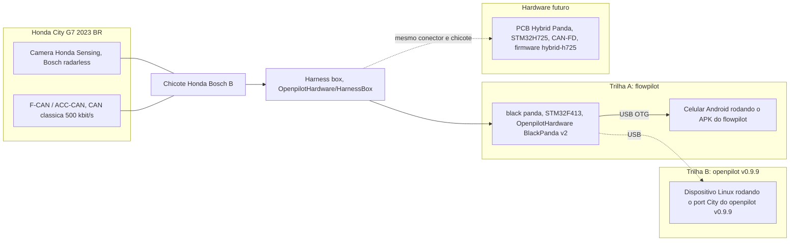

# openpilot para o Honda City G7 (2023, Brasil)

[English version: README.md](README.md)

Um esforco aberto, de ponta a ponta, para rodar openpilot / flowpilot em um Honda City de
setima geracao (2023, mercado brasileiro, Honda Sensing so com camera "Bosch radarless", CAN
classica, chicote Bosch B) usando hardware da classe black panda (STM32F413), junto com o
projeto do zero de uma PCB **Hybrid Panda** (STM32H725, capaz de CAN-FD, formato do black
panda) pensada como hardware futuro. O repositorio reune o projeto de hardware, as arvores de
firmware do panda, os ports do carro para duas pilhas de software, o procedimento de gravacao
e todas as auditorias e relatorios produzidos no caminho.

Autor: Bruno Costa ([kriptomad](https://github.com/kriptomad)). Este projeto nao e afiliado,
endossado ou suportado pela comma.ai, pela Honda ou por qualquer autor upstream.

**Nada neste repositorio foi validado em hardware real ou em carro.** Todos os status abaixo
descrevem apenas analise estatica, compilacao ou resultados de integracao continua. Nenhuma
placa foi fabricada, nenhum panda foi gravado, nenhum carro foi fingerprintado.

## Status resumido

| Trilha | Onde | Status (honesto) |
|---|---|---|
| PCB Hybrid Panda (STM32H725ZGT6, 4 camadas) | [hardware/hybrid-panda](hardware/hybrid-panda) | Projeto completo e verificado por software (2026-10-29): DRC 0 clearance / 0 unconnected / 0 curtos / 0 paridade, 73 itens restantes todos `lib_footprint_mismatch` intencionais; ERC 0 erros; conectividade reconstruida dos gerbers 0 curto / 0 aberto; revisao independente pino a pino contra o firmware panda. **Nao verificado fisicamente**; pedido de PCB nua a criterio do dono. Nada construido. |
| Firmware panda `revive-f4` (black panda no panda master atual) | [firmware/panda-revive-f4](firmware/panda-revive-f4) (submodulo) | Compila (debug e release), MISRA limpo, `test.sh` verde no fork. Nunca executado em placa. |
| Firmware panda `hybrid-h725` (alvo Hybrid Panda) | [firmware/panda-hybrid-h725](firmware/panda-hybrid-h725) (submodulo) | Compila (`panda_h7`, `panda_h7_hybrid`, `panda_h7_ldo`), MISRA limpo. Nunca executado em placa (nao existe placa). |
| Port do Honda City no openpilot v0.9.9 | [software/openpilot-v0.9.9-city-g7](software/openpilot-v0.9.9-city-g7) + [software/opendbc-v0.9.9-city-g7](software/opendbc-v0.9.9-city-g7) (submodulos) | Port completo, duas auditorias independentes, CI verde no fork (static, build, unit, cars 0-3; process replay difere apenas no bit esperado de `carParams.flags`). Nao testado em carro. |
| APK standalone do flowpilot | [software/flowpilot-city-g7](software/flowpilot-city-g7) (submodulo) | APK compila no GitHub Actions. Inicia em um Samsung Galaxy S24 Ultra ate "waiting for controls" sem panda. Nao testado com panda nem carro. |
| Guias de gravacao | [docs/flashing](docs/flashing) | Escritos a partir do codigo e dos arquivos da PCB. Nao executados em hardware. |

## Aviso de seguranca

Este e um projeto de pesquisa amador e nao validado. O openpilot e um sistema de assistencia
ao motorista que exige atencao total do condutor o tempo todo; os ports e o hardware deste
repositorio nao passaram pela validacao da comma.ai nem por nenhuma outra.

- Nao instale nada disto em um carro que vai circular em via publica antes de concluir os
  testes de bancada (enumeracao do panda, `health()`, loopback CAN), a captura CAN passiva no
  carro parado, a confirmacao do fingerprint e os testes em estacionamento com o sistema
  desengajado, nessa ordem. As listas de verificacao estao em
  [docs/flashing/flash-black-panda-city-g7.pt-br.md](docs/flashing/flash-black-panda-city-g7.pt-br.md)
  secao 7 e [hardware/research/step9-bringup-e-teste-veiculo.md](hardware/research/step9-bringup-e-teste-veiculo.md).
- A PCB Hybrid Panda nunca foi fabricada. O pacote de fabricacao e mantido apenas para
  revisao; ver [hardware/fabrication/readme.md](hardware/fabrication/readme.md).
- Os binarios de firmware sao assinados com a chave publica de debug da comma. Sao builds de
  desenvolvimento, nao releases.
- Voce e o unico responsavel pelo que fizer com este material. Verifique a legislacao local.

## Visao geral da arquitetura



- Trilha A (flowpilot): black panda gravado com o firmware compilado da arvore do flowpilot
  (commaai/panda `abdc4185`), celular conectado por USB OTG, APK do flowpilot com a camada de
  carro do City G7. E o caminho que esta sendo preparado para os primeiros testes.
- Trilha B (openpilot v0.9.9): o ultimo release do openpilot que ainda suporta o black panda
  nativamente, com o port do City G7 retroportado do opendbc upstream, rodando em um
  dispositivo Linux.
- Hardware futuro: a PCB Hybrid Panda mantem o formato, os conectores e o chicote do black
  panda, mas usa um STM32H725 para que o firmware atual do red panda (e sua pilha CAN-FD)
  possa rodar nela. O City G7 e CAN classica, portanto isso nao e exigido pelo carro; e uma
  decisao deliberada (D-05 em [docs/decisions.md](docs/decisions.md)).

## Mapa do repositorio

| Caminho | Conteudo |
|---|---|
| [README.md](README.md), [README.pt-BR.md](README.pt-BR.md) | Este documento e sua versao em ingles. |
| [LICENSE.md](LICENSE.md), [licenses/](licenses) | Inventario de licencas de todas as fontes upstream usadas, obrigacoes e textos das licencas. |
| [docs/decisions.md](docs/decisions.md) | Registro de decisoes D-01 .. D-38 do projeto Hybrid Panda (escolha do MCU, topologia SMPS, straps, politica de roteamento, itens adiados). |
| [docs/final-report.md](docs/final-report.md) | Relatorio final do protocolo de projeto do Hybrid Panda (STEP 1-9), premissas P1-P11, riscos, listas de honestidade. |
| [docs/final-audit.md](docs/final-audit.md) | Auditoria geometrica final da PCB (curtos, via-in-pad, furos, redes partidas). |
| [docs/progress.md](docs/progress.md) | Checkpoint de retomada das sessoes de projeto (historico). |
| [docs/protocol-v3.md](docs/protocol-v3.md) | O protocolo de trabalho seguido pelo projeto (historico). |
| [docs/reference-sources.md](docs/reference-sources.md) | Clones upstream e commits fixados usados como referencia somente leitura. |
| [docs/flashing/](docs/flashing) | Guia de gravacao do black panda para o City G7 (EN e pt-BR). |
| [docs/hardware/](docs/hardware) | Documentacao de hardware do Hybrid Panda: descricao do retrofit, BOM (`bom.md` + `bom.csv`), descricao do esquema, especificacao de fabricacao da PCB (EN e pt-BR). Apenas projeto; nao fabricado. |
| [docs/legacy-index.md](docs/legacy-index.md) | Indice gerado do repositorio de desenvolvimento com os caminhos antigos, mantido para rastreabilidade. |
| [hardware/hybrid-panda/](hardware/hybrid-panda) | Projeto KiCad: `HybridPanda.kicad_pcb`, `.kicad_sch`, `.kicad_pro`, footprints locais (`.pretty`), modelos 3D, simbolos; `snapshots/` guarda as copias baseline e STEP 5 da placa. |
| [hardware/fabrication/](hardware/fabrication) | Gerbers, furacao, montagem (BOM/CPL para JLCPCB), PDFs, modelo STEP, zip JLC. **Nao fabricar** (ver o readme). |
| [hardware/reports/](hardware/reports) | Relatorios DRC/ERC em JSON, netlists, BOM, auditoria SI/PI, auditoria footprint vs datasheet, auditoria de BOM, registro da campanha de correcoes (`correcoes-aplicadas.md`, `corrections/`). |
| [hardware/research/](hardware/research) | Pesquisa de engenharia: requisitos de hardware extraidos do firmware (`hrs-red-panda.md`), matriz de cobertura, tabelas de pinos, documentos STEP 3-9, relatorio do port de firmware (`hybrid-fw-port.md`), escopo pandarevive, renders. |
| [hardware/scripts/](hardware/scripts) | Automacao KiCad Python / kicad-cli usada para montar, rotear, corrigir, validar e exportar a placa, mais o gate de DRC (`corr_gate.py`). |
| [hardware/reference/datasheets/](hardware/reference/datasheets) | Datasheet do STM32H725 (DS13313) e seu texto extraido. |
| [firmware/](firmware) | Firmware do panda: dois submodulos (`panda-revive-f4`, `panda-hybrid-h725`) e binarios pre-compilados para black panda em `prebuilt/`. Ver [firmware/readme.md](firmware/readme.md). |
| [software/](software) | Tres submodulos (port openpilot v0.9.9, port opendbc v0.9.9, flowpilot) mais a documentacao dos ports, series de patches, ferramentas de auditoria e shims de teste para Windows. Ver [software/readme.md](software/readme.md). |
| [archive/](archive) | Projeto KiCad original do OpenBlackPanda do qual o Hybrid Panda deriva (`baseline-original/`) e os manifestos SHA-256 da arvore de desenvolvimento (`manifests/`). Ver [archive/readme.md](archive/readme.md). |

## Inicio rapido por trilha

### A. Instalar o APK do flowpilot

1. Baixe `flowpilot-city-g7-brazil-ffd228c.apk` do release deste repositorio
   [v0.1-city-g7-brazil](https://github.com/kriptomad/openpilot-honda-city-brasil/releases/tag/v0.1-city-g7-brazil)
   (espelho do build publicado em
   [kriptomad/flowpilot-city-g7](https://github.com/kriptomad/flowpilot-city-g7/releases/tag/v0.1-city-g7-brazil)).
2. Verifique o hash antes de instalar:
   `SHA256 493891cd62d3f2eaf094e414489d7b0dae8bde297a673c305fba6eef298d4adb`
   (235.399.803 bytes).
3. Instale com `adb install -r flowpilot-city-g7-brazil-ffd228c.apk` (ou pelo gerenciador de
   arquivos com fontes desconhecidas liberadas), desative a otimizacao de bateria para o app,
   conceda permissoes de camera, localizacao e USB.
4. Nas configuracoes do app selecione o carro `HONDA CITY 7G` (param `Mycar`). Detalhes,
   requisitos do aparelho e a lista do que nao foi verificado:
   [software/flowpilot-port/port-city-flowpilot.md](software/flowpilot-port/port-city-flowpilot.md)
   secoes 8 a 10.

### B. Gravar o black panda

Guia completo: [docs/flashing/flash-black-panda-city-g7.pt-br.md](docs/flashing/flash-black-panda-city-g7.pt-br.md)
([EN](docs/flashing/flash-black-panda-city-g7.md)). Resumo para a trilha flowpilot:

1. Hardware: Loetkolben OpenpilotHardware BlackPanda v2 (STM32F413RGT6). `SW1` leva `BOOT0`
   a nivel alto: mantenha pressionado ao conectar o cabo USB-C para entrar no bootloader DFU
   da ST (`0483:df11`). No Windows associe WinUSB com o Zadig para `0483:df11`, `bbaa:ddee` e
   `bbaa:ddcc`.
2. Lado Python: `pip install libusb1 pyusb` e execute a partir da arvore do flowpilot
   ([software/flowpilot-city-g7](software/flowpilot-city-g7)), para que o pacote `panda`
   corresponda ao firmware.
3. Grave o bootstub: `python -c "from panda import PandaDFU; PandaDFU(None).recover()"`.
   A placa reenumera como `bbaa:ddee`.
4. Grave a aplicacao:
   `python -c "from panda import Panda; Panda().flash(fn=r'firmware/prebuilt/flowpilot-black-panda/panda.bin.signed')"`
   (caminho relativo a este repositorio). A placa reenumera como `bbaa:ddcc`.
5. Verifique: `python -c "from panda import Panda; p=Panda(); print(p.get_type(), p.get_version())"`
   deve imprimir `b'\x03' DEV-a2f1983c-DEBUG`.

As tres arvores de firmware nao sao intercambiaveis; leia [Firmware](#firmware) abaixo antes
de escolher uma.

### C. Compilar o port openpilot v0.9.9

```
git clone --recurse-submodules -b v0.9.9-cityg7-blackpanda https://github.com/kriptomad/openpilot
cd openpilot
scons -j$(nproc)      # tambem compila panda/board (F4 e H7) com o safety Honda Bosch radarless
```

Ou inicialize o submodulo neste repositorio:
`git submodule update --init --recursive software/openpilot-v0.9.9-city-g7` (grande: a arvore
do openpilot com seus submodulos passa de 1 GB). O `pandad` grava o panda sozinho na
inicializacao. Notas do port, validacao e lista de bancada:
[software/openpilot-port/readme.md](software/openpilot-port/readme.md).

### D. Abrir o projeto KiCad do Hybrid Panda

- Abra [hardware/hybrid-panda/HybridPanda.kicad_pro](hardware/hybrid-panda/HybridPanda.kicad_pro)
  com o KiCad 10 (o formato do arquivo da placa e 20260206, salvo com o KiCad 10.0.7; KiCad
  8/9 nao carrega a PCB).
- DRC/ERC finais: [hardware/reports/hybrid_DRC_final.json](hardware/reports/hybrid_DRC_final.json),
  [hardware/reports/hybrid_ERC_final.json](hardware/reports/hybrid_ERC_final.json);
  relatorios por etapa em [hardware/reports/corrections/](hardware/reports/corrections).
- Saidas de fabricacao (apenas revisao): [hardware/fabrication/](hardware/fabrication).
- Reexecutar o pipeline exige o Python embutido do KiCad 10 e os caminhos configurados em
  [hardware/scripts/hp_common.py](hardware/scripts/hp_common.py); ver
  [hardware/scripts/readme.md](hardware/scripts/readme.md).

## O carro: Honda City G7 2023 (Brasil)

Fatos como usados pelos ports (fontes: commit upstream do opendbc `43006b9a`, PR
commaai/opendbc #2425 e a rota do City `56b2cf1dacdcd033|00000017--d24ffdb376`; detalhes em
[software/openpilot-port/readme.md](software/openpilot-port/readme.md) e
[software/flowpilot-port/port-city-flowpilot.md](software/flowpilot-port/port-city-flowpilot.md)):

- Plataforma `HONDA_CITY_7G`, `HondaBoschPlatformConfig` com flag `BOSCH_RADARLESS` (Honda
  Sensing so com camera). CAN classica, **nao** CAN-FD (a premissa P1 do projeto Hybrid Panda
  foi refutada por este fato; ver [hardware/research/p1-veiculo-honda-city-2023.md](hardware/research/p1-veiculo-honda-city-2023.md)).
- Chicote: Honda Bosch **B**. Safety: `SAFETY_HONDA_BOSCH` com o parametro `RADARLESS`
  (valor 8); mensagens TX 0xE4, 0x1C8, 0x30C, 0x33D; sem controle longitudinal (o ACC de
  fabrica continua controlando a velocidade).
- DBC `honda_civic_ex_2022_can_generated`; `STEER_THRESHOLD` 600; tuning lateral por torque
  `[1.2, 1.2, 0.23]` com `ki` 0.3; `steerActuatorDelay` 0,15 s; `minSteerSpeed` vindo do
  CarParams (23 km/h no port flowpilot, 14 mph no `CARS.md`).
- Transmissao: CVT convencional reportada por `GEARBOX` (0x191) com o layout upstream
  `GEARBOX_CVT` (`1 P 2 R 3 N 4 D 7 L 10 S`); a posicao `S` e aceita.
- Sem freio de estacionamento eletrico: o carro nao envia `EPB_STATUS` (0x1C2). O codigo da
  v0.9.9 exigia essa mensagem a 50 Hz em todo carro Bosch, o que faria o parser CAN dar
  timeout; a deteccao upstream `HAS_EPB` (commit `6fa346ed`) foi retroportada, incluindo a
  mudanca de `EPB_STATUS` para `_honda_common.dbc` no DBC.
- Fingerprint por firmware: 6 ECUs (eps, gateway, srs, fwdRadar, vsa, transmission) identicas
  ao upstream; o port flowpilot carrega ainda um fingerprint CAN de 36 mensagens no bus 0.

## Hardware: Hybrid Panda

Objetivo: uma placa no formato do black panda (mesmos conectores, mesma harness box, mesmo
estagio de potencia do OpenBlackPanda) que rode o firmware oficial do red panda sem
modificacao, em um **STM32H725ZGT6 (LQFP-144, Direct SMPS)**, mantendo os quatro
transceivers TJA1042TK/3 (CAN FD ate 5 Mbit/s). As decisoes com suas justificativas estao em
[docs/decisions.md](docs/decisions.md); o estado do projeto inteiro esta em
[docs/final-report.md](docs/final-report.md).

O que difere de um red panda e do baseline OpenBlackPanda:

- MCU STM32H725ZGT6 em vez de STM32F413 (D-02); 1 MB de flash exigido pelo firmware (P9);
  LQFP-144 porque o firmware precisa de pinos das portas F/G e configura Direct SMPS nesse
  encapsulamento (P7). O MCU fica no lado inferior (D-21).
- Straps de HW_TYPE: PF7-PF10 em nivel baixo para que o firmware upstream detecte
  `HW_TYPE_RED_PANDA` (D-08); PF9 em jumper de solda `JP1` para selecionar o id
  `HW_TYPE_HYBRID_PANDA` adicionado pelo firmware `hybrid-h725` (D-35).
- Modulo GPS removido (D-03); sem terminacao de 120 ohm (D-04); SBU para ADC via 10 kohm em
  serie e clamp BAT54S em PC4/PA1 (D-12/D-16); STB dos transceivers com pull-up externo
  (D-09); VFBSMPS ligado a VCAP como exige a topologia Direct SMPS (D-35, encontrado pelo
  port de firmware e pela auditoria SI/PI).
- Placa crescida +5 mm ao sul e +3 mm a leste (D-24, D-33): 50,625 x 46,75 mm; os arquivos
  do gabinete original nao servem mais.
- Verificacao de paridade com o firmware: todos os 36 pinos exigidos pelo firmware do red
  panda caem nos pinos esperados de U7 (`parity_red_h7`, 36/36). Os relatorios do firmware
  pandarevive e hybrid estao em [hardware/research/hybrid-fw-port.md](hardware/research/hybrid-fw-port.md).

Numeros atuais (apos a campanha de correcoes pos-auditoria, ver
[hardware/reports/correcoes-aplicadas.md](hardware/reports/correcoes-aplicadas.md)):

| Verificacao | Resultado |
|---|---|
| DRC total | 182 -> 135 -> 73 itens (passe de verificacao 2026-10-29) |
| DRC categorias bloqueantes | clearance 0, unconnected 0, paridade com esquematico 0, curtos 0, trilhas cruzando 0, courtyard 0 |
| DRC restante | apenas lib_footprint_mismatch 73 (footprints editados localmente de proposito, ~61 diferencas so de grafico/caminho 3D); itens hole_clearance, silk e text_height corrigidos |
| DRC com regras JLCPCB 4 camadas | furo-cobre 0; residuais inerentes ao conector TYPE-C-31-M-04 (anel P1 fila B 0,125 mm, furo-furo 0,40 mm) e cobre-borda 0,20 mm em duas trilhas (valor publicado pela JLC), ver [adversarial-review.md](hardware/reports/verification-pcb/adversarial-review.md) |
| ERC | 0 erros, 373 avisos |
| Revisao dos gerbers | conectividade de cobre reconstruida dos gerbers + furacao e comparada com a netlist, duas vezes (dois scripts independentes): 142 nets, 0 curtos, 0 abertos; 268 furos = 268 furos da PCB; contorno unico fechado 51,02 x 46,75 mm |
| Revisao pino a pino | todos os pinos de sinal e alimentacao do U7 conferidos contra `red.h`/`hybrid.h` e DS13313 (AF FDCAN, USB, SWD, BOOT0, straps HW_TYPE, topologia Direct SMPS): nenhum erro encontrado |
| Auditoria geometrica final | curtos 0, via-in-pad 0, 9 vias termicas intencionais em pads expostos |
| BOM | codigos LCSC conferidos no espelho jlcparts: 2 erros de valor corrigidos (C23/C24 18 pF -> C1549, C64 2,2 uF -> C12530); U1 AP22615AWU-7 nao esta mais na JLC (comprar em outro lugar); footprints x datasheets: 0 divergencia |
| Stackup / impedancia | 4 camadas, 1,59 mm; par USB reroteado acoplado 0,35/0,15 mm (~90 ohm no JLC7628), CAN_DIFF 0,22/0,23 mm; so analitico, camadas internas nao sao planos solidos, logo os valores sao otimistas; sem TDR |
| Verificacao fisica | **nenhuma** - nenhuma placa construida |

Os itens adiados (exigem relayout parcial ou decisao do dono, nenhum bloqueia o DRC) estao na
secao 5 de [hardware/reports/correcoes-aplicadas.md](hardware/reports/correcoes-aplicadas.md)
e em D-37.

### Documentacao de hardware

Documentos detalhados, apenas de projeto (nada foi fabricado ou testado), em pt-BR com
versao EN:

| Documento | Conteudo |
|---|---|
| [docs/hardware/red-panda-retrofit-on-black-panda.pt-br.md](docs/hardware/red-panda-retrofit-on-black-panda.pt-br.md) ([EN](docs/hardware/red-panda-retrofit-on-black-panda.md)) | Documento principal: comparacao black/red/Hybrid Panda, diagrama de blocos, o que foi mantido/substituido/adicionado, mapa de pinos do H725, CAN, alimentacao, USB, depuracao, implicacoes de firmware, estado de verificacao. |
| [docs/hardware/bom.pt-br.md](docs/hardware/bom.pt-br.md) ([EN](docs/hardware/bom.md)), [docs/hardware/bom.csv](docs/hardware/bom.csv) | Lista de materiais por funcao com estado de MPN/LCSC; CSV regenerado por `hardware/scripts/gen-docs-bom.py`. |
| [docs/hardware/schematic.pt-br.md](docs/hardware/schematic.pt-br.md) ([EN](docs/hardware/schematic.md)) | Descricao do esquema por bloco funcional, pull-ups, redes de interesse, estado do ERC. |
| [docs/hardware/pcb-specification.pt-br.md](docs/hardware/pcb-specification.pt-br.md) ([EN](docs/hardware/pcb-specification.md)) | Especificacao de fabricacao: dimensoes, stackup, regras de projeto, alvos de impedancia, resumo do DRC, lista de arquivos de fabricacao, estado de verificacao. |

## Firmware

Existem tres arvores de firmware e elas **nao sao intercambiaveis**: falam versoes diferentes
do protocolo USB com o software do outro lado. Grave a arvore que corresponde ao software que
voce vai rodar. O City G7 em si nao precisa de mudanca no firmware (o safety Honda Bosch
radarless existe nas tres).

| Arvore | Fonte | Usar com | Pre-compilado |
|---|---|---|---|
| panda do flowpilot (commaai/panda `abdc4185`, achatado no repo do flowpilot) | `panda/` dentro de [software/flowpilot-city-g7](software/flowpilot-city-g7) | APK do flowpilot (trilha A) | [firmware/prebuilt/flowpilot-black-panda](firmware/prebuilt/flowpilot-black-panda) |
| submodulo panda do openpilot 0.9.9 (commaai/panda `e462c34d`) | `panda/` dentro de [software/openpilot-v0.9.9-city-g7](software/openpilot-v0.9.9-city-g7) | port openpilot v0.9.9 (trilha B) | nenhum; o `scons` compila e o `pandad` grava |
| `revive-f4` (STM32F4 / black panda restaurado no panda master atual) | [firmware/panda-revive-f4](firmware/panda-revive-f4) | openpilot master futuro quando o lado host existir (pandarevive); testes de bancada do proprio firmware | [firmware/prebuilt/revive-f4-black-panda](firmware/prebuilt/revive-f4-black-panda) |
| `hybrid-h725` (alvo Hybrid Panda, H7) | [firmware/panda-hybrid-h725](firmware/panda-hybrid-h725) | PCB Hybrid Panda (nao existe placa) | nenhum |

Hashes dos binarios pre-compilados (SHA-256; tambem em cada `SHA256SUMS.txt`):

| Arquivo | flowpilot black panda | revive-f4 black panda |
|---|---|---|
| `panda.bin.signed` | `A067B0A1109CF6BE29719964B3DBEBBFF999012DB8F87560B1177469B9D3CB02` | `EB07FF3F7DF5068D7A956D9330458FF03CDA280E12B03400CEEA26CF419991AF` |
| `bootstub.panda.bin` | `C3FDFE023B8D10F366EA40E78729D7A2ED224498FD331E7AA33A1E70BCA75E76` | `3C49135BB18D71BBC96C9C6161EEA8472C6A4C1AF1D43860E4FCE5275A8EB221` |
| `version` | `DEV-a2f1983c-DEBUG` | `DEV-e78c41e6-DEBUG` |

Todos os binarios sao assinados com a chave publica de debug da comma (`certs/debug`). Um
panda com bootstub de release da comma rejeita aplicacoes assinadas com debug, entao o
bootstub precisa ser gravado antes por DFU; uma placa Loetkolben recem-montada comeca vazia e
aceita o bootstub de debug diretamente. Ver [firmware/readme.md](firmware/readme.md).

## Software

| Trilha | Submodulo | Branch | Base upstream | O que foi feito |
|---|---|---|---|---|
| Port City no openpilot v0.9.9 | [software/openpilot-v0.9.9-city-g7](software/openpilot-v0.9.9-city-g7) | `v0.9.9-cityg7-blackpanda` (`9ad0dbb08`) | openpilot tag v0.9.9 `8aadf02b` (2025-06-05), panda `e462c34d` | submodulo opendbc apontado para o fork, entradas em `CARS.md`/`RELEASES.md`, correcoes de CI para forks (hash do wheel metadrive, job de release pulado), backports dos upstream `bae7a610f` (marcha sport) e `839a77334` (`torqued` para Honda). |
| Port City no opendbc v0.9.9 | [software/opendbc-v0.9.9-city-g7](software/opendbc-v0.9.9-city-g7) | `firmwarecityg7-v0.9.9` (`6cbc8005`) | opendbc `e370a036` (v0.9.9) | cherry-pick byte a byte do upstream `43006b9a` (City), backport `HAS_EPB` (`6fa346ed`), ordem do `steerActuatorDelay` (`28a16218`), `ki` 0.3 so para o City, layout `GEARBOX_CVT` (`9ef0b1fb`), ruff fixado em 0.11.13. |
| flowpilot | [software/flowpilot-city-g7](software/flowpilot-city-g7) | `flowpilot-city-g7-brazil` (`94248de`) | jagheterfredrik/flowpilot master `9ea918ea` (2025-03-04, importado como snapshot tarball) | camada de carro do City (values, interface, carstate, fingerprints, DBC, override de torque), correcao da assinatura `CarInterface.apply` em 10 marcas, `CARS.md`, helper SCons para Windows do firmware panda, reparos de build/CI com toolchain fixada: python-for-android `b0efb9f3`, Android NDK r25b, Python 3.11.5, buildozer 1.6.0, Cython 3.0.12 / numpy 2.2.3. |

As series `git format-patch` equivalentes para o opendbc (9 patches) e o openpilot (10
patches) ficam em [software/openpilot-port/patches/](software/openpilot-port/patches) para que
o port possa ser reaplicado em qualquer clone das bases upstream.

O que o CI faz:

- Fork do opendbc: `test.sh` (ubuntu-24.04) e `--ubsan` passam; `macos` e os jobs de mutacao
  do safety falham tambem na base intocada (toolchain do runner).
- Fork do openpilot, workflow `selfdrive_tests.yaml`: analise estatica, build, testes
  unitarios e `cars (0..3)` (`test_models.py` em rotas reais de todos os carros suportados,
  City incluido) passam. O process replay difere apenas em `carParams.flags` nos dois
  segmentos de referencia Honda (o novo bit `HAS_EPB`); o build macOS falha no runner
  (pre-existente).
- Fork do flowpilot, workflow `Build`: compila as bibliotecas nativas, o firmware do panda e o
  APK dentro do Docker; falha se nenhum APK for produzido ou se faltarem libs nativas.
  Primeiro APK completo: run 40697331404 em `ffd228c`.

Auditorias: [software/openpilot-port/auditoria-port-city-v099.md](software/openpilot-port/auditoria-port-city-v099.md)
(commit por commit, CarParams campo a campo, TX byte a byte) e a auditoria adversarial
independente [software/openpilot-port/audit2/auditoria2-independente.md](software/openpilot-port/audit2/auditoria2-independente.md)
(replay do codigo real de `carstate`/`carcontroller` sobre a rota, 0 diferencas em 33 campos
de carState). Ambas em portugues.

## Repositorios relacionados

| Repositorio | Papel |
|---|---|
| [kriptomad/panda](https://github.com/kriptomad/panda) | Fork do firmware panda: branches `revive-f4` e `hybrid-h725`. |
| [kriptomad/openpilot](https://github.com/kriptomad/openpilot) | Fork do openpilot: branch `v0.9.9-cityg7-blackpanda`. |
| [kriptomad/opendbc](https://github.com/kriptomad/opendbc) | Fork do opendbc: branch `firmwarecityg7-v0.9.9`. |
| [kriptomad/flowpilot-city-g7](https://github.com/kriptomad/flowpilot-city-g7) | Fork do flowpilot: branch `flowpilot-city-g7-brazil`, releases do APK. |
| [kriptomad/PandaH7Openpilot](https://github.com/kriptomad/PandaH7Openpilot) | Historico de desenvolvimento / substituido por este repositorio. |
| [kriptomad/Redesign-Panda-Black-Revival-Port-Firmware-City-G7](https://github.com/kriptomad/Redesign-Panda-Black-Revival-Port-Firmware-City-G7) | Historico de desenvolvimento / substituido por este repositorio. |
| pandarevive (lado openpilot) | Placeholder: o lado host do openpilot para o `revive-f4` no master atual ainda nao existe (ver [hardware/research/pandarevive-scope.md](hardware/research/pandarevive-scope.md) secao 7). |

## Roadmap / itens em aberto

1. Chegada do hardware: Loetkolben BlackPanda v2 e HarnessBox montados, chicote Bosch B,
   cabos USB-C de dados e OTG.
2. Primeira gravacao por DFU seguindo [docs/flashing](docs/flashing); registrar a enumeracao
   real, a saida de `health()` e da versao, e atualizar o guia de "esperado" para "observado".
3. Teste de bancada: enumeracao USB no celular, comportamento do `pandaflash` do APK,
   loopback CAN.
4. Carro: captura CAN passiva com o carro parado, fingerprint (`HONDA CITY 7G`), verificacao
   do modo e dos parametros de safety, sanidade do `carState`, testes em estacionamento
   desengajado e depois engajado.
5. Flowpilot: confirmar o comportamento do controlador de torque com o framework antigo
   (desvio D4 do port flowpilot), deteccao em tempo de execucao de `HAS_EPB`/CVT e desempenho
   de OpenCL/modelo no celular real.
6. openpilot v0.9.9: decidir e preparar o dispositivo host Linux (D-06 ainda aberta).
7. PCB Hybrid Panda: resolver os itens adiados (D-37), confirmar todos os codigos LCSC no
   catalogo da JLCPCB, confirmar stackup e impedancia com o fabricante, revisar os gerbers no
   GerbView, montar 1-2 prototipos, bring-up conforme o STEP 9.
8. pandarevive: o lado openpilot para o black panda no panda master atual.

## Creditos e licencas

- comma.ai: [panda](https://github.com/commaai/panda), [openpilot](https://github.com/commaai/openpilot),
  [opendbc](https://github.com/commaai/opendbc) (MIT). O suporte ao Honda City 7G em si foi
  contribuido upstream em commaai/opendbc #2425.
- Lukas Loetkolben: OpenpilotHardware [BlackPanda v2](https://github.com/lukasloetkolben/OpenBlackPanda)
  e HarnessBox (MIT), o baseline do qual o Hybrid Panda deriva e o hardware usado pelas
  trilhas black panda. O aviso MIT e mantido no projeto KiCad derivado.
- flowpilot: Mankaran Singh / flowdriveai, e o fork de APK standalone de
  [jagheterfredrik](https://github.com/jagheterfredrik/flowpilot) usado como base.
- KiCad (projeto), Freerouting 2.5.0 (autorroteamento, GPL, nao redistribuido aqui),
  STMicroelectronics (datasheet DS13313, citado; redistribuicao sujeita aos termos da ST).
- Autor do repositorio: Bruno Costa (kriptomad). O trabalho original de hardware (projeto
  Hybrid Panda, saidas de fabricacao, relatorios e pesquisa de hardware) e licenciado sob
  CERN-OHL-S-2.0; software e documentacao originais sob MIT. O inventario de licencas, as
  obrigacoes e os textos das licencas estao em [LICENSE.md](LICENSE.md) e [licenses/](licenses).

## Clonando

Com todas as trilhas:

```
git clone --recurse-submodules https://github.com/kriptomad/openpilot-honda-city-brasil.git
```

Aviso: so o submodulo do openpilot (com seus proprios submodulos) passa de 1 GB. Para clonar
apenas documentacao e hardware, omita `--recurse-submodules` e inicialize as trilhas sob
demanda:

```
git clone https://github.com/kriptomad/openpilot-honda-city-brasil.git
cd openpilot-honda-city-brasil
git submodule update --init firmware/panda-revive-f4            # panda, revive-f4
git submodule update --init firmware/panda-hybrid-h725          # panda, hybrid-h725
git submodule update --init software/opendbc-v0.9.9-city-g7     # port opendbc
git submodule update --init software/flowpilot-city-g7          # flowpilot (tem submodulos proprios: use --recursive)
git submodule update --init --recursive software/openpilot-v0.9.9-city-g7   # port openpilot, grande
```

Os arquivos de texto usam fim de linha LF (`.gitattributes`). A documentacao escrita durante
o desenvolvimento esta em portugues sem acentos (ASCII); os dois READMEs e o guia de gravacao
tem versao em ingles.
