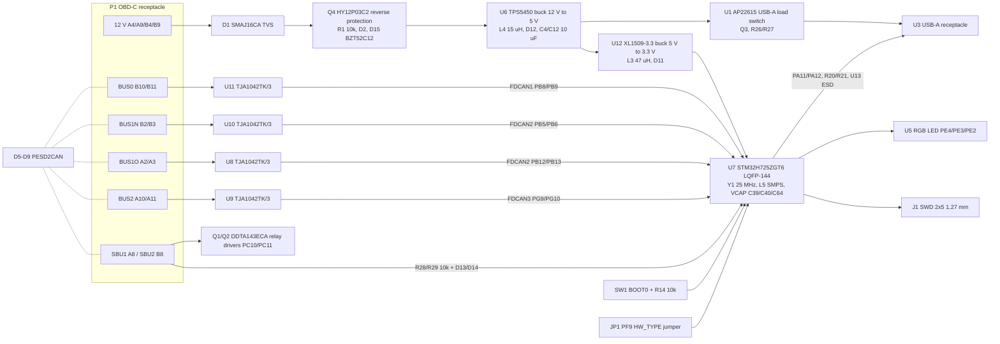

# Hybrid Panda: red panda architecture retrofitted onto the OpenBlackPanda board

Status: design only. Nothing described here has been fabricated, assembled, powered or
tested. All numbers come from the KiCad files, scripts and reports in this repository
(paths are given relative to the repository root). Where a value is not recorded in any
repository file it is written as "not determined".

Companion documents: [bom.md](bom.md), [schematic.md](schematic.md),
[pcb-specification.md](pcb-specification.md). Portuguese version:
[red-panda-retrofit-on-black-panda.pt-br.md](red-panda-retrofit-on-black-panda.pt-br.md).

## 1. Purpose and scope

The Hybrid Panda is a printed-circuit-board design that places the microcontroller and CAN
front end required by comma.ai's **red panda** firmware onto the physical platform of
Lukas Loetkolben's **OpenBlackPanda v2** (an open re-implementation of comma's
discontinued black panda). The goal, stated in `docs/final-report.md` section 1 and
`docs/decisions.md` D-01/D-02, is a board that:

- keeps the black panda form factor, the OBD-C (USB-C receptacle) harness connector, the
  USB-A host connector, the 12 V to 5 V to 3.3 V power stage and the harness box of the
  OpenBlackPanda;
- runs the upstream red panda firmware (`HW_TYPE_RED_PANDA = 7`) on an
  **STM32H725ZGT6 (LQFP-144)** with four CAN FD capable transceivers, so that the board
  behaves as a red panda from the point of view of openpilot;
- optionally identifies itself as a distinct board (`HW_TYPE_HYBRID_PANDA = 11`) when the
  `hybrid-h725` firmware branch is used (D-35, `hardware/research/hybrid-fw-port.md`).

"Retrofit" in this document means: the OpenBlackPanda KiCad project was taken as the
baseline (`archive/baseline-original/BlackPanda/kicad_project/`), the MCU and its
support circuitry were replaced, the CAN front end was adapted, the GPS block was
removed, and the board outline was enlarged. It does **not** mean modifying an existing
physical black panda; the result is a new PCB.

Relation to the three boards involved:

| Board | Owner / licence | Role here |
|---|---|---|
| black panda (comma.ai) | comma.ai, end of life; firmware `board/boards/black.h` removed from the panda master | Reference for the form factor, connectors and the original F413 pin usage (via OpenBlackPanda). |
| OpenBlackPanda v2 | Lukas Loetkolben, MIT (`archive/baseline-original/BlackPanda/README.md`) | Baseline KiCad project (schematic, PCB, footprints, 3D models). |
| red panda (comma.ai) | comma.ai; hardware files **not published** (`hardware/research/p2-hardware-red-panda.md`) | Target firmware; the hardware requirements were derived from the firmware only (`hardware/research/hrs-red-panda.md`). |

Because comma does not publish red panda schematics, every red panda hardware fact in
this document is an inference from the firmware (marked [F] in `hrs-red-panda.md`) or an
engineering decision recorded in `docs/decisions.md`.

## 2. Comparison: black panda, red panda, Hybrid Panda

| Item | black panda / OpenBlackPanda v2 | red panda (from firmware) | Hybrid Panda |
|---|---|---|---|
| MCU | STM32F413RGTx (`U7`, baseline schematic) | STM32H725 family; package must report LQFP144 or UFBGA169 in `SYSCFG->PKGR` for SMPS (`hrs-red-panda.md` section 2) | STM32H725ZGT6 (`U7`, `HybridPanda.kicad_sch`) |
| Package | LQFP-64 10x10 mm (`Package_QFP:LQFP-64_10x10mm_P0.5mm`) | not published; LQFP144 or UFBGA169 inferred | LQFP-144 20x20 mm 0.5 mm pitch (`Package_QFP:LQFP-144_20x20mm_P0.5mm`), mounted on the bottom side (D-21) |
| Flash / RAM | 1 MB flash (suffix G); RAM not determined from repository sources | 1 MB flash required (app at 0x08020000, provisioning at 0x080FFFC0); linker RAM map 128 K DTCM + 320 K AXI + 32 K SRAM1/2 + 16 K SRAM4 + 64 K ITCM (`hrs-red-panda.md` section 7) | same as red panda (same die family, suffix G) |
| Core regulator | internal LDO | Direct SMPS on LQFP144 (`clock.h`, PKGR check) | Direct SMPS: `L5` 2.2 uH, VFBSMPS tied to VCAP (D-35, PCR-2) |
| CAN controllers | bxCAN x3 (CAN1 PB8/PB9, CAN2 PB5/PB6 or PB12/PB13, CAN3 PA8/PA15) classic CAN only | FDCAN1/2/3, CAN FD | FDCAN1 PB8/PB9, FDCAN2 PB5/PB6 and PB12/PB13, FDCAN3 PG9/PG10 (`step4-esquematico-h725.md` section 4) |
| Transceivers | 4x TJA1042TK/3 (`U8`-`U11`), used in classic mode | not published | 4x TJA1042TK/3 (`U8`-`U11`) kept; CAN FD capable to 5 Mbit/s (D-20) |
| Buses on connector | bus0, bus1 (normal/OBD switched), bus2 | same topology (`hrs-red-panda.md` section 5) | same: BUS0 (`U11`), BUS1N (`U10`), BUS1O (`U8`), BUS2 (`U9`) |
| CAN termination | none on the panda; harness box terminates (D-04) | not published | none (D-04) |
| USB device | USB FS on PA11/PA12 to USB-A `U3` (host connects with A-to-A/C cable) | USB FS PA11/PA12 (`hrs-red-panda.md` section 6) | USB FS PA11/PA12 to `U3`, series `R20`/`R21` 22 R, ESD `U13` |
| Power input | 12 V from OBD-C pins A4/A9/B4/B9; `D1` TVS, `Q4` P-FET reverse protection, `U6` TPS5450 12 V to 5 V, `U12` XL1509 5 V to 3.3 V | not published | same chain kept; `R1` 1 k to 10 k, zener `D15` added for Q4 gate (SI/PI items 4/5) |
| Crystal | 16 MHz `Y1` X322516MLB4SI, 10 pF loads | 25 MHz HSE expected by `clock.h` (`step4` section 2) | 25 MHz `Y1` X322525MOB4SI, `C23`/`C24` 18 pF |
| Harness connector | OBD-C, `P1` TYPE-C-31-M-04 | OBD-C | `P1` TYPE-C-31-M-04 kept |
| Harness | comma / Loetkolben harness box; SBU1/SBU2 ignition detection | same | same; SBU conditioned by `R28`/`R29` + `D13`/`D14` (D-12/D-16) |
| Debug | SWD pads (baseline); BOOT0 button `SW1` + `R14`; BOOT1 `R22` | SWD; BOOT0 pin 135 (`hrs-red-panda.md` section 8) | `J1` ARM 10-pin 1.27 mm SWD; `SW1` + `R14`; no BOOT1 on H7 |
| Firmware target | `board/boards/black.h` (historical, `panda_legacy_f4`) | `board/boards/red.h`, target `panda_h7` | upstream `red.h` unmodified, or `board/boards/hybrid.h` in branch `hybrid-h725` |
| panda `hw_type` | not determined from repository sources | `HW_TYPE_RED_PANDA = 7` | 7 with `JP1` closed; `HW_TYPE_HYBRID_PANDA = 11` with `JP1` open (`hybrid-fw-port.md` line 18) |
| Board size | 47.625 x 41.75 mm, 2 layers (baseline `BlackPanda.kicad_pcb`) | not published | 50.625 x 46.75 mm, 4 layers (section 11) |

## 3. Block diagram

Sources: pad-to-net assignment of `hardware/hybrid-panda/HybridPanda.kicad_pcb`;
`hardware/research/p10-obdc-harness-sbu.md` section 1 for the connector pinout.

## 4. What was kept, replaced, added and removed

Reference designators are those of `hardware/hybrid-panda/HybridPanda.kicad_sch`; the
baseline is `archive/baseline-original/BlackPanda/kicad_project/BlackPanda.kicad_sch`.
The baseline schematic has 86 components; the Hybrid Panda schematic has 119 (plus 6
fiducials present only on the PCB).

### 4.1 Kept from OpenBlackPanda v2 (same reference, same or equivalent part)

| Function | References |
|---|---|
| OBD-C receptacle | `P1` TYPE-C-31-M-04 |
| USB-A receptacle | `U3` 10.0 QHHTZB6.3 |
| Input protection | `D1` SMAJ16CA, `D2` BAS40WS, `Q4` HY12P03C2 (`R1` value changed, see 4.2) |
| 12 V to 5 V | `U6` TPS5450DDAR, `L4` 15 uH MWSA1004S-150MT, `D12` SM540C/B540C, `C37`, `R5`/`R6` feedback |
| 5 V to 3.3 V | `U12` XL1509-3.3, `L3` 47 uH SMMS0650-470M, `D11` B320AE/B340A |
| USB-A power switch | `U1` AP22615AWU-7, `Q3` PDTC114EU, `R9`, `R26`, `R27`, `D10` BAS70H |
| CAN transceivers and ESD | `U8`-`U11` TJA1042TK/3, `D5`-`D9` PESD2CAN |
| SBU / ignition detection | `Q1`/`Q2` DDTA143ECA, `R23`/`R24` 10 k pull-ups |
| Status LED | `U5` FM-B1921RGBA, `R17`/`R18`/`R19` |
| Voltage sense divider | `R2` 1 k / `R3` 10 k (12V_Protected to VoltageSens) |
| USB load sense | `R15`/`R16` 10 k/10 k |
| BOOT0 | `SW1` SKQGAFE010, `R14` 10 k pull-down |
| Bulk and decoupling capacitors | `C1`-`C8`, `C10`-`C12`, `C14`, `C16`-`C21`, `C26`-`C34` |

### 4.2 Replaced

| Baseline | Hybrid Panda | Reason (source) |
|---|---|---|
| `U7` STM32F413RGTx LQFP-64 | `U7` STM32H725ZGT6 LQFP-144, bottom side | red panda firmware target; 1 MB flash, ports F/G, Direct SMPS (D-02, P7, P9, D-21) |
| `Y1` 16 MHz + `C23`/`C24` 10 pF | `Y1` 25 MHz X322525MOB4SI + `C23`/`C24` 18 pF | `clock.h` expects 25 MHz HSE (`step4` section 2) |
| `R1` 1 k | `R1` 10 k 0603 | Q4 gate bias current / dissipation (SI/PI item 4, `correcoes-aplicadas.md`) |
| `C4`/`C12` 2.2 uF | `C4`/`C12` 10 uF 0805 | TPS5450 input capacitance (SI/PI item 6) |
| CAN STB driven directly by MCU | STB with external 10 k pull-ups `R30`-`R33` to +3V3 | transceivers default to standby while MCU pins are high-Z (D-09) |

### 4.3 Added

| References | Function | Source |
|---|---|---|
| `C38` 100 nF | NRST filter | `step4` |
| `C39`, `C40` 2.2 uF 0603, `C64` 2.2 uF 0402 | VCAP capacitors (pins 17/68/103/140 net VCAP) | `step4`, SI/PI |
| `L5` DFE201610E-2R2M 2.2 uH, `C41` 220 pF, `C42` 10 uF, `C65` 4.7 uF | Direct SMPS output filter (VLXSMPS to VCAP) | D-35, AN5419 |
| `FB1` 600 R, `C43` 1 uF, `C44` 100 nF | VDDA / VREF+ filter | `step4` |
| `C45`-`C63` (100 nF, 1 uF, 4.7 uF) | per-pin VDD decoupling for the 144-pin package | `step4` |
| `D13`, `D14` BAT54S, `R28`, `R29` 10 k | SBU1/SBU2 ADC clamps to +3V3/GND (12 V tolerant input) | D-12, D-16 |
| `D15` BZT52C12 | Q4 Vgs limiter | SI/PI item 5 |
| `R30`-`R33` 10 k | CAN STB pull-ups | D-09 |
| `U13` USBLC6-2SC6, `R20`/`R21` 22 R | USB ESD array and series resistors | SI/PI item 8 |
| `J1` 2x5 1.27 mm SMD header | ARM 10-pin SWD | `step4` |
| `JP1` solder jumper | PF9 HW_TYPE id1 bit (closed = 7 red, open = 11 hybrid) | D-35, PCR-1 |
| `FID1`-`FID6` | assembly fiducials (3 per side, PCB only) | `docs/final-audit.md` |

### 4.4 Removed

| Baseline references | Function | Source |
|---|---|---|
| `U4` NEO-M8M, `U2` SiP32431, `ANT1` U.FL, `L1` 27 nH, `C9`, `C15`, `R10` | GPS receiver and its power switch | D-03 (red panda firmware does not use GPS) |
| `R22` | BOOT1 pull-down | STM32H7 has no BOOT1 pin (`p3-p4-p5-p6-firmware-pinmap.md`) |
| `C25` 4.7 uF | F413 decoupling | replaced by the H725 scheme |
| SPI and UART global labels (`SPI_*`, `UART_*`, `GPS_*`) | unused interfaces | not routed on the Hybrid Panda |

## 5. MCU pin mapping

Pin numbers are LQFP-144. Nets are the global labels of `HybridPanda.kicad_sch`
cross-checked against the pad nets of `U7` in `HybridPanda.kicad_pcb`. The F413 column is
the OpenBlackPanda/black panda equivalent from `hardware/research/hrs-red-panda.md`
section 9 and `step3-engenharia-reversa-tabela-hibrida.md`. Alternate-function numbers
are those recorded in `hardware/research/step4-esquematico-h725.md` section 4 and
`hybrid-fw-port.md` section 2.

| H725 pin | Port | Function | AF | Net | Connected to | F413 equivalent |
|---|---|---|---|---|---|---|
| 136 | PB8 | FDCAN1_RX (bus0) | AF9 | BUS0_RX | `U11` pin 4 | PB8 CAN1_RX |
| 137 | PB9 | FDCAN1_TX (bus0) | AF9 | BUS0_TX | `U11` pin 1 | PB9 CAN1_TX |
| 124 | PG11 | STB transceiver bus0 | GPIO out | BUS0_STB | `U11` pin 8, `R30` | PC1 |
| 132 | PB5 | FDCAN2_RX (bus1 normal) | AF9 | BUS1N_RX | `U10` pin 4 | PB5 CAN2_RX |
| 133 | PB6 | FDCAN2_TX (bus1 normal) | AF9 | BUS1N_TX | `U10` pin 1 | PB6 CAN2_TX |
| 130 | PB3 | STB transceiver bus1 normal | GPIO out | BUS1N_STB | `U10` pin 8, `R31` | PC13 |
| 72 | PB12 | FDCAN2_RX (bus1 OBD) | AF9 | BUS1O_RX | `U8` pin 4 | PB12 CAN2_RX |
| 73 | PB13 | FDCAN2_TX (bus1 OBD) | AF9 | BUS1O_TX | `U8` pin 1 | PB13 CAN2_TX |
| 131 | PB4 | STB transceiver bus1 OBD | GPIO out | BUS1O_STB | `U8` pin 8, `R32` | PB10 |
| 122 | PG9 | FDCAN3_TX (bus2) | AF2 | BUS2_TX | `U9` pin 1 | PA8 CAN3_TX (AF11) |
| 123 | PG10 | FDCAN3_RX (bus2) | AF2 | BUS2_RX | `U9` pin 4 | PA15 CAN3_RX (AF11) |
| 121 | PD7 | STB transceiver bus2 | GPIO out | BUS2_STB | `U9` pin 8, `R33` | PA0 |
| 100 | PA11 | USB_OTG_HS DM (FS PHY) | AF10 | USB_D- | `R20` to `U3` | PA11 |
| 101 | PA12 | USB_OTG_HS DP (FS PHY) | AF10 | USB_D+ | `R21` to `U3` | PA12 |
| 47 | PC4 | ADC SBU1 | analog | SBU1_ADC | `R28`, `D13` | PC0 (ch10) |
| 38 | PA1 | ADC SBU2 | analog | SBU2_ADC | `R29`, `D14` | PC3 (ch13) |
| 109 | PC10 | relay SBU1 drive | GPIO out | relay_SBU1 | `Q2` base | PC10 |
| 110 | PC11 | relay SBU2 drive | GPIO out | relay_SBU2 | `Q1` base | PC11 |
| 3 | PE4 | LED red (active low) | GPIO OD | LED_RED | `R19` | PC9 |
| 2 | PE3 | LED green (active low) | GPIO OD | LED_GREEN | `R18` | PC7 |
| 1 | PE2 | LED blue (active low) | GPIO OD | LED_BLUE | `R17` | PC6 |
| 52 | PF11 | ADC VoltageSens (12 V / 11) | analog | VoltageSens | `R2`/`R3` | PC2 |
| 50 | PB1 | ADC 5VOUT_S (5 V / 2) | analog | 5VOUT_S | `R15`/`R16` | PC4 |
| 74 | PB14 | USB-A load switch enable | GPIO out | USB_LOAD | `Q3` base | PB1 |
| 25 | PH0 | OSC_IN 25 MHz | HSE | HSE_IN | `Y1` pin 1, `C23` | PH0 (16 MHz) |
| 26 | PH1 | OSC_OUT 25 MHz | HSE | HSE_OUT | `Y1` pin 3, `C24` | PH1 |
| 102 | PA13 | SWDIO | AF0 | SWDIO | `J1` pin 2 | PA13 |
| 107 | PA14 | SWCLK | AF0 | SWCLK | `J1` pin 4 | PA14 |
| 27 | NRST | reset | - | NRST | `J1` pin 10, `C38` | NRST |
| 135 | BOOT0 | boot select | - | BOOT0 | `SW1`, `R14` | BOOT0 (pin 60) |
| 21, 22, 24 | PF7, PF8, PF10 | HW_TYPE id1 bits = 0 | GPIO in | GND | direct | none (black panda has no id straps in this form) |
| 23 | PF9 | HW_TYPE id1 bit 2 | GPIO in | Net-(JP1-B) | `JP1` to GND | none |
| 116, 117, 120 | PD4, PD5, PD6 | HW_TYPE id2 | GPIO in | not connected | internal pull-up reads 1 (D-08) | none |
| 15 | VLXSMPS | SMPS switch node | - | VLXSMPS | `L5` pin 1, `C41` | none (LDO on F413) |
| 17, 68, 103, 140 | VFBSMPS / VCAP | core supply | - | VCAP | `L5` pin 2, `C39`, `C40`, `C42`, `C64` | VCAP (single) |
| 35, 36 | VREF+, VDDA | analog supply | - | VDDA | `FB1`, `C43`, `C44` | VDDA |
| 7, 8, 13, 16, 19, 32, 42, 56, 70, 71, 79, 90-92, 105, 106, 119, 129, 142-144 | VDD, VBAT, VDDLDO, VDDSMPS, VDD33USB, VDD50USB | 3.3 V supplies | - | +3V3 | `C45`-`C63`, `C65` | VDD/VBAT/VDDUSB |

VDD50USB is connected to +3V3 (D-14); the firmware does not use VBUS sensing on PA9
(`hrs-red-panda.md` section 6). All other GPIO of `U7` are left unconnected (77 no-connect
markers in the schematic).

## 6. CAN front end

- Transceivers: four NXP **TJA1042TK/3** in HVSON8 (`Package_DFN_QFN:DFN-8-1EP_3x3mm`),
  `U8` (BUS1O), `U9` (BUS2), `U10` (BUS1N), `U11` (BUS0). The /3 variant has a 3.3 V I/O
  reference: pin 5 (VIO) is on +3V3, pin 3 (VCC) on +5V. The part is CAN FD capable up to
  5 Mbit/s according to D-20; the firmware default bit rates are those of upstream panda
  (500 kbit/s nominal, 2 Mbit/s data when FD is enabled by the host), not changed by the port.
- Standby: pin 8 (STB) of each transceiver is driven by the MCU (PG11, PB3, PB4, PD7) and
  pulled to +3V3 by `R30`-`R33` 10 k, so the transceivers stay in standby until the firmware
  drives the pin low (D-09). Logic: 1 = standby, 0 = normal, as in `black.h`/`red.h`.
- Mapping to the OBD-C receptacle `P1` (`p10-obdc-harness-sbu.md` section 1, D-13):

| Firmware bus | Transceiver | P1 pins | Harness side meaning |
|---|---|---|---|
| bus0 | `U11` | B10 (L), B11 (H) | car CAN (powertrain) after cable crossing |
| bus1 normal | `U10` | B2 (H), B3 (L) | camera CAN |
| bus1 OBD | `U8` | A2 (H), A3 (L) | OBD / car CAN when relay open |
| bus2 | `U9` | A10 (L), A11 (H) | radar CAN |

- ESD: `D5` (SBU1/SBU2), `D6` (BUS1O), `D7` (BUS2), `D8` (BUS1N), `D9` (BUS0) are
  PESD2CAN dual-line clamps to GND.
- Termination: none on the board; the harness box provides the 120 ohm terminations
  (D-04).
- Differential routing: netclass `CAN_DIFF` width 0.25 mm, gap 0.20 mm (`HybridPanda.kicad_pro`).
  The analytic estimate in `step6-roteamento-impedancia.md` gave 108 to 143 ohm
  differential for the 120 ohm target; no field solver or fabricator confirmation exists.

## 7. Power

| Stage | Parts | Notes (source) |
|---|---|---|
| Input | `P1` pins A4/A9/B4/B9 = +12V | vehicle 12 V via harness box |
| Protection | `D1` SMAJ16CA TVS to GND; `Q4` HY12P03C2 P-channel reverse-polarity switch; `R1` 10 k gate bias; `D2` BAS40WS; `D15` BZT52C12 zener limiting Vgs | `R1` 1 k to 10 k and `D15` added by SI/PI items 4 and 5 (`hardware/reports/correcoes-aplicadas.md`) |
| 12 V to 5 V | `U6` TPS5450DDAR, `L4` 15 uH, `D12` SM540C, `C4`/`C12` 10 uF + `C6`/`C7` 2.2 uF input, `C3`/`C10`/`C18`-`C21` 47 uF output, `C37` bootstrap, `R5`/`R6` feedback (VSENSE) | input caps increased from 2.2 uF (SI/PI item 6) |
| 5 V to 3.3 V | `U12` XL1509-3.3E1, `L3` 47 uH, `D11`, `C16` 47 uF | kept from baseline |
| USB-A 5 V | `U1` AP22615AWU-7 load switch, `Q3` PDTC114EU level shifter, `R26`/`R27`, `D10` BAS70H, `C17`/`C34` | `U1` not found in the JLCPCB catalogue; alternative TPS2553DBVR would need a new `R27` (`bom-report.md`) |
| MCU core | Direct SMPS: `L5` 2.2 uH DFE201610E-2R2M, `C41` 220 pF, `C42` 10 uF, `C65` 4.7 uF; VCAP `C39`/`C40`/`C64` 2.2 uF | D-35; VFBSMPS tied to VCAP as required by AN5419 for direct SMPS |
| Analog | `FB1` 600 R @ 100 MHz, `C43` 1 uF, `C44` 100 nF | VDDA/VREF+ |
| Decoupling | 100 nF `C45`-`C59` (0402) at each VDD pin pair; `C60`-`C63` 4.7 uF / 1 uF bulk | `step4` |

Rails present on the board: +12V, 12V_Protected, +5V, USB_PWR (switched 5 V to `U3`),
+3V3, VCAP (about 1.0 to 1.2 V, core), VDDA. Copper pours: GND on all four layers,
+3V3 on In1.Cu under the MCU, +5V on In1.Cu/In2.Cu/F.Cu/B.Cu, +12V and 12V_Protected on
B.Cu, USB_PWR on F.Cu (zone list from `HybridPanda.kicad_pcb`).

Current consumption: not determined. No power budget is recorded in the repository;
the SI/PI audit (`hardware/reports/si-pi-audit/`) treats regulator margins qualitatively.
Measurement points: VoltageSens = 12V_Protected x 1/11 into PF11; 5VOUT_S = +5V x 1/2
into PB1.

## 8. USB

- Connector: `U3` USB-A receptacle (10.0 QHHTZB6.3, through-hole shell), as on the
  baseline. The host connects with an A-to-A or A-to-C cable; there is no USB-C data path on
  `P1` (its A6/A7/B6/B7 and CC pins are unconnected).
- Data: PA11/PA12 through `R20`/`R21` 22 R (0402) to `U3` pins 2/3; nets USB_D-/USB_D+ on
  the MCU side, USB_R_D-/USB_R_D+ on the connector side.
- ESD: `U13` USBLC6-2SC6 in flow-through arrangement (connector side pins 1/3, MCU side
  pins 6/4, VBUS pin 5 on USB_PWR) - SI/PI item 8.
- VBUS: `U1` switches +5V to USB_PWR under MCU control (USB_LOAD, PB14, through `Q3`);
  `D10` BAS70H from +5V to USB_PWR; `C17` 47 uF and `C34` 100 nF on USB_PWR. The MCU does
  not sense VBUS (red panda firmware does not use it).
- CC resistors: not applicable (USB-A device port; CC1/CC2 of `P1` unconnected).
- Routing: netclass `USB` width 0.20 mm, gap 0.25 mm. After the correction campaign the
  USB_R_D pair is routed as a coupled pair on In1.Cu with 0.2 mm width / 0.3 mm gap
  (`correcoes-aplicadas.md` item 19). The 90 ohm differential target has not been confirmed
  with a fabricator stackup.

## 9. Debug and programming

- SWD: `J1` 2x5 1.27 mm SMD header in ARM Cortex 10-pin layout (pin 1 +3V3, 2 SWDIO,
  4 SWCLK, 10 NRST, GND on 3/5/9; 6/7/8 unconnected). Bottom side.
- Reset: NRST with `C38` 100 nF to GND.
- BOOT0: `SW1` push-button to +3V3 with `R14` 10 k pull-down, mirroring the baseline `SW1`.
  Holding `SW1` at power-up selects the ST system bootloader (0x1FF09804) and the USB DFU
  interface (`dfu-util -d 0483:df11`, `hybrid-fw-port.md`). The STM32H7 has no BOOT1 pin;
  alternative boot addresses are option bytes and were not changed (not determined).
- panda bootstub: flash sector 0 (128 K) holds the bootstub, application at 0x08020000
  (`hrs-red-panda.md` section 7). The bootstub checks the application signature, so a
  third-party board must run a `DEBUG` (unsigned) build or be provisioned by the owner
  (`hybrid-fw-port.md`).

## 10. Firmware implications

The firmware submodule `firmware/panda-hybrid-h725` (branch `hybrid-h725` of
`kriptomad/panda`, commits a8babfea and 78e37994) was **not checked out** when this
document was written; the following facts come from `hardware/research/hybrid-fw-port.md`.

- Upstream `red.h` runs unmodified when `JP1` is closed (PF7-PF10 = 0, id1 = 0, hw_type 7).
  Caveat recorded in `hybrid-fw-port.md` section 11: `red_init` leaves PB14 (USB_LOAD) as
  open-drain high, which puts `Q3`/`U1` at the switching threshold, so the USB-A port may
  be off with the pure upstream binary.
- Branch `hybrid-h725` adds `board/boards/hybrid.h` and `HW_TYPE_HYBRID_PANDA = 11`,
  detected when id1 == 4 (`JP1` open). Build targets: `panda_h7_hybrid` (`-DHYBRID_BOARD`,
  PB14 push-pull low at init) and `panda_h7_ldo` fallback (`HYBRID_LDO=1`, forces the LDO;
  only meaningful for a board whose VFBSMPS is not tied to VCAP). `hybrid.h` reuses the red
  panda pin set (CAN, STB, SBU ADC on PC4/PA1, relays PC10/PC11, LEDs PE4/PE3/PE2) and
  declares fan, siren, SOM, SPI, IR and amplifier as unused.
- Clocks: HSE 25 MHz (PLL DIVM=5, N=48, SYSCLK 240 MHz per `hybrid-fw-port.md`); FDCAN and
  USB clock trees are those of upstream `clock.h`, unchanged.
- Compiled with GNU Arm toolchain 14.2.Rel1; never executed on hardware.
- Pin parity: the `parity_red_h7` check in `hardware/scripts/step7_validate.py` confirms
  that all 36 pins required by `red.h` land on the expected `U7` pads (36/36,
  `hardware/research/step7-validacao.md`).

## 11. Design verification state

| Check | Result | Source |
|---|---|---|
| Board | 50.625 x 46.75 mm nominal outline (plus a 0.4 mm step east of the USB-A connector for y < 48.6 mm), 4 copper layers, 1.59 mm | `HybridPanda.kicad_pcb` Edge.Cuts, D-24, D-33, `correcoes-aplicadas.md` item 33 |
| Components | 125 footprints (80 top, 45 bottom), 119 schematic references + 6 fiducials, 526 pads; through-hole: `U6` thermal vias, `U3`, `P1` | `HybridPanda.kicad_pcb` |
| Nets | 142 named nets in the PCB (62 signal/power nets, 80 `unconnected-*` single-pad nets) | `HybridPanda.kicad_pcb` |
| Routing | 1218 track segments (F.Cu 628, B.Cu 352, In1 152, In2 86), 242 vias (203 x 0.6/0.3 mm, 39 x 0.7/0.3 mm), 17 zones | `HybridPanda.kicad_pcb` |
| DRC (KiCad 10.0.7, 2026-10-28) | 135 items: clearance 0, unconnected 0, shorting items 0, schematic parity 0; remaining hole_clearance 8 (`P1` footprint, inherited), lib_footprint_mismatch 73, silk_edge_clearance 4, silk_over_copper 1, silk_overlap 4, text_height 45 | `hardware/reports/hybrid_DRC_final.json` |
| ERC (KiCad 10.0.7) | 0 errors, 373 warnings (endpoint_off_grid 145, lib_symbol_mismatch 185, pin_to_pin 37, lib_symbol_issues 6) | `hardware/reports/hybrid_ERC_final.json` |
| Netlist parity | 119 components / 119 footprints, 481 pads matched, 0 divergences | `hardware/research/step7-validacao.md` |
| Geometric audit | 0 shorts, 0 via-in-pad, 0 split nets | `docs/final-audit.md` |
| Footprint vs datasheet audit | done; `Q1`/`Q2`/`Q3` pad geometry corrected in step 1 of the correction campaign | `hardware/reports/footprint-audit/`, `correcoes-aplicadas.md` |
| SI/PI audit | 36 items reviewed analytically; critical ones applied (VFBSMPS to VCAP, R1, D15, C4/C12, U13), others deferred | `hardware/reports/si-pi-audit/` |
| BOM | 119 references, 118 with MPN, 117 with LCSC code; `JP1` (no part) and `U1` (not in catalogue) without; **no LCSC code confirmed** | `hardware/reports/bom-real/bom-report.md`, `docs/hardware/bom.csv` |
| Fabrication package | regenerated 2026-10-29 by `step8_fabricate.py` after the software verification pass; not physically verified | `hardware/fabrication/readme.md` |

Explicit statement: **the Hybrid Panda has not been fabricated, assembled, powered,
flashed or connected to a vehicle.** No electrical, thermal, EMC or functional
measurement exists. The fabrication files in `hardware/fabrication/` are review outputs.

Deferred items (D-37, `correcoes-aplicadas.md` section 5): SI/PI items 9, 10, 16, 21/22/23,
25, 27, 29, 34, 36; `C8` package 0603; `U1` alternative part; LCSC catalogue confirmation;
CPL rotation normalisation for JLCPCB; impedance confirmation with the fabricator;
courtyard clearances below 1 mm inside the transceiver block (inherited from the
baseline); new enclosure (the baseline STL files no longer fit, D-24/D-33).

Risks:

- 73 footprints differ from their library versions (edited locally on purpose); the
  footprint-vs-datasheet audit covers the edited ones but no physical fit check exists.
- `P1` footprint carries 8 inherited hole_clearance violations against the 0.25 mm rule.
- LCSC codes were obtained by web search and are not confirmed; four are flagged
  TO-VERIFY in `bom-report.md` (`C64` C23733, `C4`/`C12` C2932476, `D15` C571379,
  `C23`/`C24` C1555).
- CAN and USB impedances were only estimated analytically for an assumed stackup.
- The red panda reference hardware is not public; all red panda hardware requirements are
  inferences from firmware.
- The Honda City 2023 (BR) target vehicle uses classic CAN only (D-05); CAN FD operation
  of this board has no vehicle use case in this repository.

## 12. References

- `README.md` - sections "Hardware: Hybrid Panda" and "Repository map".
- `docs/decisions.md` - D-01 to D-38.
- `docs/final-report.md`, `docs/final-audit.md`, `docs/protocol-v3.md`.
- `hardware/research/hrs-red-panda.md` - hardware requirements derived from the red panda firmware.
- `hardware/research/p2-hardware-red-panda.md`, `p10-obdc-harness-sbu.md`, `p3-p4-p5-p6-firmware-pinmap.md`.
- `hardware/research/step3-engenharia-reversa-tabela-hibrida.md` to `step9-bringup-e-teste-veiculo.md`.
- `hardware/research/hybrid-fw-port.md` - firmware port report (branch `hybrid-h725`).
- `hardware/reports/correcoes-aplicadas.md`, `hardware/reports/si-pi-audit/`, `hardware/reports/footprint-audit/`, `hardware/reports/bom-real/bom-report.md`.
- `hardware/reports/hybrid_DRC_final.json`, `hardware/reports/hybrid_ERC_final.json`.
- `hardware/hybrid-panda/HybridPanda.kicad_sch`, `HybridPanda.kicad_pcb`, `HybridPanda.kicad_pro`.
- `archive/baseline-original/BlackPanda/` - OpenBlackPanda v2 by Lukas Loetkolben (MIT).
- `hardware/fabrication/readme.md` - fabrication package and status notice.
