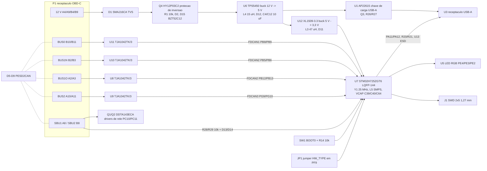

# Hybrid Panda: arquitetura do red panda adaptada a placa OpenBlackPanda

Estado: apenas projeto. Nada do que esta descrito aqui foi fabricado, montado, energizado ou
testado. Todos os numeros vem dos arquivos KiCad, scripts e relatorios deste repositorio
(caminhos relativos a raiz do repositorio). Quando um valor nao esta registrado em nenhum
arquivo do repositorio, escreve-se "nao determinado".

Documentos relacionados: [bom.pt-br.md](bom.pt-br.md), [schematic.pt-br.md](schematic.pt-br.md),
[pcb-specification.pt-br.md](pcb-specification.pt-br.md). Versao em ingles:
[red-panda-retrofit-on-black-panda.md](red-panda-retrofit-on-black-panda.md).

## 1. Objetivo e escopo

A Hybrid Panda e um projeto de placa de circuito impresso que coloca o microcontrolador e o
front end CAN exigidos pelo firmware do **red panda** da comma.ai sobre a plataforma fisica
da **OpenBlackPanda v2** de Lukas Loetkolben (reimplementacao aberta do black panda
descontinuado da comma). O objetivo, declarado em `docs/final-report.md` secao 1 e em
`docs/decisions.md` D-01/D-02, e uma placa que:

- mantem o formato do black panda, o conector de chicote OBD-C (receptaculo USB-C), o
  conector USB-A, a cadeia de alimentacao 12 V -> 5 V -> 3,3 V e a harness box da
  OpenBlackPanda;
- executa o firmware upstream do red panda (`HW_TYPE_RED_PANDA = 7`) em um
  **STM32H725ZGT6 (LQFP-144)** com quatro transceptores com capacidade CAN FD, de modo que
  a placa se comporte como um red panda do ponto de vista do openpilot;
- opcionalmente se identifica como placa distinta (`HW_TYPE_HYBRID_PANDA = 11`) quando o
  ramo de firmware `hybrid-h725` e usado (D-35, `hardware/research/hybrid-fw-port.md`).

"Retrofit" neste documento significa: o projeto KiCad da OpenBlackPanda foi tomado como
baseline (`archive/baseline-original/BlackPanda/kicad_project/`), o MCU e seus circuitos de
apoio foram substituidos, o front end CAN foi adaptado, o bloco GPS foi removido e o
contorno da placa foi ampliado. Nao significa modificar um black panda fisico existente; o
resultado e uma PCB nova.

Relacao entre as tres placas envolvidas:

| Placa | Dono / licenca | Papel aqui |
|---|---|---|
| black panda (comma.ai) | comma.ai, fim de vida; firmware `board/boards/black.h` removido do master do panda | Referencia de formato, conectores e uso original dos pinos do F413 (via OpenBlackPanda). |
| OpenBlackPanda v2 | Lukas Loetkolben, MIT (`archive/baseline-original/BlackPanda/README.md`) | Projeto KiCad baseline (esquema, PCB, footprints, modelos 3D). |
| red panda (comma.ai) | comma.ai; arquivos de hardware **nao publicados** (`hardware/research/p2-hardware-red-panda.md`) | Firmware alvo; os requisitos de hardware foram derivados apenas do firmware (`hardware/research/hrs-red-panda.md`). |

Como a comma nao publica esquemas do red panda, todo fato de hardware do red panda neste
documento e uma inferencia a partir do firmware (marcada [F] em `hrs-red-panda.md`) ou uma
decisao de engenharia registrada em `docs/decisions.md`.

## 2. Comparacao: black panda, red panda, Hybrid Panda

| Item | black panda / OpenBlackPanda v2 | red panda (a partir do firmware) | Hybrid Panda |
|---|---|---|---|
| MCU | STM32F413RGTx (`U7`, esquema baseline) | familia STM32H725; o encapsulamento deve reportar LQFP144 ou UFBGA169 em `SYSCFG->PKGR` para SMPS (`hrs-red-panda.md` secao 2) | STM32H725ZGT6 (`U7`, `HybridPanda.kicad_sch`) |
| Encapsulamento | LQFP-64 10x10 mm (`Package_QFP:LQFP-64_10x10mm_P0.5mm`) | nao publicado; LQFP144 ou UFBGA169 inferido | LQFP-144 20x20 mm passo 0,5 mm (`Package_QFP:LQFP-144_20x20mm_P0.5mm`), montado na face inferior (D-21) |
| Flash / RAM | 1 MB flash (sufixo G); RAM nao determinada pelas fontes do repositorio | 1 MB flash exigido (app em 0x08020000, provisioning em 0x080FFFC0); mapa de RAM do linker 128 K DTCM + 320 K AXI + 32 K SRAM1/2 + 16 K SRAM4 + 64 K ITCM (`hrs-red-panda.md` secao 7) | igual ao red panda (mesma familia, sufixo G) |
| Regulador do nucleo | LDO interno | Direct SMPS em LQFP144 (`clock.h`, verificacao PKGR) | Direct SMPS: `L5` 2,2 uH, VFBSMPS ligado a VCAP (D-35, PCR-2) |
| Controladores CAN | bxCAN x3 (CAN1 PB8/PB9, CAN2 PB5/PB6 ou PB12/PB13, CAN3 PA8/PA15), apenas CAN classico | FDCAN1/2/3, CAN FD | FDCAN1 PB8/PB9, FDCAN2 PB5/PB6 e PB12/PB13, FDCAN3 PG9/PG10 (`step4-esquematico-h725.md` secao 4) |
| Transceptores | 4x TJA1042TK/3 (`U8`-`U11`), usados em modo classico | nao publicado | 4x TJA1042TK/3 (`U8`-`U11`) mantidos; capacidade CAN FD ate 5 Mbit/s (D-20) |
| Barramentos no conector | bus0, bus1 (normal/OBD comutado), bus2 | mesma topologia (`hrs-red-panda.md` secao 5) | igual: BUS0 (`U11`), BUS1N (`U10`), BUS1O (`U8`), BUS2 (`U9`) |
| Terminacao CAN | nenhuma no panda; a harness box termina (D-04) | nao publicado | nenhuma (D-04) |
| USB device | USB FS em PA11/PA12 para o USB-A `U3` (host liga com cabo A-A ou A-C) | USB FS PA11/PA12 (`hrs-red-panda.md` secao 6) | USB FS PA11/PA12 para `U3`, serie `R20`/`R21` 22 R, ESD `U13` |
| Entrada de energia | 12 V dos pinos A4/A9/B4/B9 do OBD-C; TVS `D1`, P-FET `Q4` contra inversao, `U6` TPS5450 12 V -> 5 V, `U12` XL1509 5 V -> 3,3 V | nao publicado | mesma cadeia mantida; `R1` 1 k -> 10 k, zener `D15` adicionado no gate do Q4 (itens SI/PI 4/5) |
| Cristal | 16 MHz `Y1` X322516MLB4SI, cargas 10 pF | 25 MHz HSE esperado por `clock.h` (`step4` secao 2) | 25 MHz `Y1` X322525MOB4SI, `C23`/`C24` 18 pF |
| Conector de chicote | OBD-C, `P1` TYPE-C-31-M-04 | OBD-C | `P1` TYPE-C-31-M-04 mantido |
| Chicote | harness box comma / Loetkolben; deteccao de ignicao por SBU1/SBU2 | igual | igual; SBU condicionado por `R28`/`R29` + `D13`/`D14` (D-12/D-16) |
| Depuracao | pads SWD (baseline); botao BOOT0 `SW1` + `R14`; BOOT1 `R22` | SWD; BOOT0 pino 135 (`hrs-red-panda.md` secao 8) | `J1` ARM 10 pinos 1,27 mm SWD; `SW1` + `R14`; sem BOOT1 no H7 |
| Alvo de firmware | `board/boards/black.h` (historico, `panda_legacy_f4`) | `board/boards/red.h`, alvo `panda_h7` | `red.h` upstream sem alteracao, ou `board/boards/hybrid.h` no ramo `hybrid-h725` |
| `hw_type` do panda | nao determinado pelas fontes do repositorio | `HW_TYPE_RED_PANDA = 7` | 7 com `JP1` fechado; `HW_TYPE_HYBRID_PANDA = 11` com `JP1` aberto (`hybrid-fw-port.md` linha 18) |
| Tamanho da placa | 47,625 x 41,75 mm, 2 camadas (baseline `BlackPanda.kicad_pcb`) | nao publicado | 50,625 x 46,75 mm, 4 camadas (secao 11) |

## 3. Diagrama de blocos

Fontes: atribuicao pad -> rede de `hardware/hybrid-panda/HybridPanda.kicad_pcb`;
`hardware/research/p10-obdc-harness-sbu.md` secao 1 para a pinagem do conector.

## 4. O que foi mantido, substituido, adicionado e removido

Os designadores sao os de `hardware/hybrid-panda/HybridPanda.kicad_sch`; o baseline e
`archive/baseline-original/BlackPanda/kicad_project/BlackPanda.kicad_sch`. O esquema
baseline tem 86 componentes; o esquema da Hybrid Panda tem 119 (mais 6 fiduciais presentes
apenas na PCB).

### 4.1 Mantido da OpenBlackPanda v2 (mesma referencia, mesma peca ou equivalente)

| Funcao | Referencias |
|---|---|
| Receptaculo OBD-C | `P1` TYPE-C-31-M-04 |
| Receptaculo USB-A | `U3` 10.0 QHHTZB6.3 |
| Protecao de entrada | `D1` SMAJ16CA, `D2` BAS40WS, `Q4` HY12P03C2 (valor de `R1` alterado, ver 4.2) |
| 12 V -> 5 V | `U6` TPS5450DDAR, `L4` 15 uH MWSA1004S-150MT, `D12` SM540C/B540C, `C37`, realimentacao `R5`/`R6` |
| 5 V -> 3,3 V | `U12` XL1509-3.3, `L3` 47 uH SMMS0650-470M, `D11` B320AE/B340A |
| Chave de energia USB-A | `U1` AP22615AWU-7, `Q3` PDTC114EU, `R9`, `R26`, `R27`, `D10` BAS70H |
| Transceptores CAN e ESD | `U8`-`U11` TJA1042TK/3, `D5`-`D9` PESD2CAN |
| SBU / deteccao de ignicao | `Q1`/`Q2` DDTA143ECA, pull-ups `R23`/`R24` 10 k |
| LED de estado | `U5` FM-B1921RGBA, `R17`/`R18`/`R19` |
| Divisor de tensao | `R2` 1 k / `R3` 10 k (12V_Protected -> VoltageSens) |
| Sensor de carga USB | `R15`/`R16` 10 k/10 k |
| BOOT0 | `SW1` SKQGAFE010, pull-down `R14` 10 k |
| Capacitores de volume e desacoplamento | `C1`-`C8`, `C10`-`C12`, `C14`, `C16`-`C21`, `C26`-`C34` |

### 4.2 Substituido

| Baseline | Hybrid Panda | Motivo (fonte) |
|---|---|---|
| `U7` STM32F413RGTx LQFP-64 | `U7` STM32H725ZGT6 LQFP-144, face inferior | alvo do firmware red panda; 1 MB flash, portas F/G, Direct SMPS (D-02, P7, P9, D-21) |
| `Y1` 16 MHz + `C23`/`C24` 10 pF | `Y1` 25 MHz X322525MOB4SI + `C23`/`C24` 18 pF | `clock.h` espera HSE de 25 MHz (`step4` secao 2) |
| `R1` 1 k | `R1` 10 k 0603 | corrente de polarizacao / dissipacao no gate do Q4 (item SI/PI 4, `correcoes-aplicadas.md`) |
| `C4`/`C12` 2,2 uF | `C4`/`C12` 10 uF 0805 | capacitancia de entrada do TPS5450 (item SI/PI 6) |
| STB dos CAN acionado diretamente pelo MCU | STB com pull-ups externos `R30`-`R33` 10 k para +3V3 | transceptores em standby enquanto os pinos do MCU estao em alta impedancia (D-09) |

### 4.3 Adicionado

| Referencias | Funcao | Fonte |
|---|---|---|
| `C38` 100 nF | filtro de NRST | `step4` |
| `C39`, `C40` 2,2 uF 0603, `C64` 2,2 uF 0402 | capacitores VCAP (pinos 17/68/103/140, rede VCAP) | `step4`, SI/PI |
| `L5` DFE201610E-2R2M 2,2 uH, `C41` 220 pF, `C42` 10 uF, `C65` 4,7 uF | filtro de saida do Direct SMPS (VLXSMPS -> VCAP) | D-35, AN5419 |
| `FB1` 600 R, `C43` 1 uF, `C44` 100 nF | filtro VDDA / VREF+ | `step4` |
| `C45`-`C63` (100 nF, 1 uF, 4,7 uF) | desacoplamento por pino VDD do encapsulamento de 144 pinos | `step4` |
| `D13`, `D14` BAT54S, `R28`, `R29` 10 k | grampos dos ADC SBU1/SBU2 para +3V3/GND (entrada tolerante a 12 V) | D-12, D-16 |
| `D15` BZT52C12 | limitador de Vgs do Q4 | item SI/PI 5 |
| `R30`-`R33` 10 k | pull-ups de STB dos CAN | D-09 |
| `U13` USBLC6-2SC6, `R20`/`R21` 22 R | matriz ESD USB e resistores serie | item SI/PI 8 |
| `J1` header SMD 2x5 1,27 mm | SWD ARM 10 pinos | `step4` |
| `JP1` jumper de solda | bit id1 de HW_TYPE em PF9 (fechado = 7 red, aberto = 11 hybrid) | D-35, PCR-1 |
| `FID1`-`FID6` | fiduciais de montagem (3 por face, apenas PCB) | `docs/final-audit.md` |

### 4.4 Removido

| Referencias do baseline | Funcao | Fonte |
|---|---|---|
| `U4` NEO-M8M, `U2` SiP32431, `ANT1` U.FL, `L1` 27 nH, `C9`, `C15`, `R10` | receptor GPS e sua chave de energia | D-03 (o firmware red panda nao usa GPS) |
| `R22` | pull-down de BOOT1 | o STM32H7 nao tem pino BOOT1 (`p3-p4-p5-p6-firmware-pinmap.md`) |
| `C25` 4,7 uF | desacoplamento do F413 | substituido pelo esquema do H725 |
| Rotulos globais SPI e UART (`SPI_*`, `UART_*`, `GPS_*`) | interfaces nao usadas | nao roteadas na Hybrid Panda |

## 5. Mapeamento de pinos do MCU

Numeros de pino do LQFP-144. As redes sao os rotulos globais de `HybridPanda.kicad_sch`
conferidos com as redes dos pads de `U7` em `HybridPanda.kicad_pcb`. A coluna F413 e o
equivalente OpenBlackPanda/black panda de `hardware/research/hrs-red-panda.md` secao 9 e
`step3-engenharia-reversa-tabela-hibrida.md`. Os numeros de funcao alternativa sao os
registrados em `hardware/research/step4-esquematico-h725.md` secao 4 e
`hybrid-fw-port.md` secao 2.

| Pino H725 | Porta | Funcao | AF | Rede | Ligado a | Equivalente F413 |
|---|---|---|---|---|---|---|
| 136 | PB8 | FDCAN1_RX (bus0) | AF9 | BUS0_RX | `U11` pino 4 | PB8 CAN1_RX |
| 137 | PB9 | FDCAN1_TX (bus0) | AF9 | BUS0_TX | `U11` pino 1 | PB9 CAN1_TX |
| 124 | PG11 | STB transceptor bus0 | GPIO out | BUS0_STB | `U11` pino 8, `R30` | PC1 |
| 132 | PB5 | FDCAN2_RX (bus1 normal) | AF9 | BUS1N_RX | `U10` pino 4 | PB5 CAN2_RX |
| 133 | PB6 | FDCAN2_TX (bus1 normal) | AF9 | BUS1N_TX | `U10` pino 1 | PB6 CAN2_TX |
| 130 | PB3 | STB transceptor bus1 normal | GPIO out | BUS1N_STB | `U10` pino 8, `R31` | PC13 |
| 72 | PB12 | FDCAN2_RX (bus1 OBD) | AF9 | BUS1O_RX | `U8` pino 4 | PB12 CAN2_RX |
| 73 | PB13 | FDCAN2_TX (bus1 OBD) | AF9 | BUS1O_TX | `U8` pino 1 | PB13 CAN2_TX |
| 131 | PB4 | STB transceptor bus1 OBD | GPIO out | BUS1O_STB | `U8` pino 8, `R32` | PB10 |
| 122 | PG9 | FDCAN3_TX (bus2) | AF2 | BUS2_TX | `U9` pino 1 | PA8 CAN3_TX (AF11) |
| 123 | PG10 | FDCAN3_RX (bus2) | AF2 | BUS2_RX | `U9` pino 4 | PA15 CAN3_RX (AF11) |
| 121 | PD7 | STB transceptor bus2 | GPIO out | BUS2_STB | `U9` pino 8, `R33` | PA0 |
| 100 | PA11 | USB_OTG_HS DM (PHY FS) | AF10 | USB_D- | `R20` -> `U3` | PA11 |
| 101 | PA12 | USB_OTG_HS DP (PHY FS) | AF10 | USB_D+ | `R21` -> `U3` | PA12 |
| 47 | PC4 | ADC SBU1 | analogico | SBU1_ADC | `R28`, `D13` | PC0 (ch10) |
| 38 | PA1 | ADC SBU2 | analogico | SBU2_ADC | `R29`, `D14` | PC3 (ch13) |
| 109 | PC10 | acionamento rele SBU1 | GPIO out | relay_SBU1 | base de `Q2` | PC10 |
| 110 | PC11 | acionamento rele SBU2 | GPIO out | relay_SBU2 | base de `Q1` | PC11 |
| 3 | PE4 | LED vermelho (ativo baixo) | GPIO OD | LED_RED | `R19` | PC9 |
| 2 | PE3 | LED verde (ativo baixo) | GPIO OD | LED_GREEN | `R18` | PC7 |
| 1 | PE2 | LED azul (ativo baixo) | GPIO OD | LED_BLUE | `R17` | PC6 |
| 52 | PF11 | ADC VoltageSens (12 V / 11) | analogico | VoltageSens | `R2`/`R3` | PC2 |
| 50 | PB1 | ADC 5VOUT_S (5 V / 2) | analogico | 5VOUT_S | `R15`/`R16` | PC4 |
| 74 | PB14 | habilitacao da chave USB-A | GPIO out | USB_LOAD | base de `Q3` | PB1 |
| 25 | PH0 | OSC_IN 25 MHz | HSE | HSE_IN | `Y1` pino 1, `C23` | PH0 (16 MHz) |
| 26 | PH1 | OSC_OUT 25 MHz | HSE | HSE_OUT | `Y1` pino 3, `C24` | PH1 |
| 102 | PA13 | SWDIO | AF0 | SWDIO | `J1` pino 2 | PA13 |
| 107 | PA14 | SWCLK | AF0 | SWCLK | `J1` pino 4 | PA14 |
| 27 | NRST | reset | - | NRST | `J1` pino 10, `C38` | NRST |
| 135 | BOOT0 | selecao de boot | - | BOOT0 | `SW1`, `R14` | BOOT0 (pino 60) |
| 21, 22, 24 | PF7, PF8, PF10 | bits id1 de HW_TYPE = 0 | GPIO in | GND | direto | nenhum (o black panda nao tem straps desta forma) |
| 23 | PF9 | bit 2 de id1 de HW_TYPE | GPIO in | Net-(JP1-B) | `JP1` -> GND | nenhum |
| 116, 117, 120 | PD4, PD5, PD6 | id2 de HW_TYPE | GPIO in | nao ligados | pull-up interno le 1 (D-08) | nenhum |
| 15 | VLXSMPS | no de comutacao do SMPS | - | VLXSMPS | `L5` pino 1, `C41` | nenhum (LDO no F413) |
| 17, 68, 103, 140 | VFBSMPS / VCAP | alimentacao do nucleo | - | VCAP | `L5` pino 2, `C39`, `C40`, `C42`, `C64` | VCAP (unico) |
| 35, 36 | VREF+, VDDA | alimentacao analogica | - | VDDA | `FB1`, `C43`, `C44` | VDDA |
| 7, 8, 13, 16, 19, 32, 42, 56, 70, 71, 79, 90-92, 105, 106, 119, 129, 142-144 | VDD, VBAT, VDDLDO, VDDSMPS, VDD33USB, VDD50USB | alimentacoes 3,3 V | - | +3V3 | `C45`-`C63`, `C65` | VDD/VBAT/VDDUSB |

VDD50USB esta ligado a +3V3 (D-14); o firmware nao usa deteccao de VBUS em PA9
(`hrs-red-panda.md` secao 6). Todos os demais GPIO de `U7` ficam sem ligacao (77 marcas de
nao conexao no esquema).

## 6. Front end CAN

- Transceptores: quatro NXP **TJA1042TK/3** em HVSON8 (`Package_DFN_QFN:DFN-8-1EP_3x3mm`),
  `U8` (BUS1O), `U9` (BUS2), `U10` (BUS1N), `U11` (BUS0). A variante /3 tem referencia de
  I/O em 3,3 V: pino 5 (VIO) em +3V3, pino 3 (VCC) em +5V. A peca suporta CAN FD ate
  5 Mbit/s segundo D-20; as taxas padrao do firmware sao as do panda upstream (500 kbit/s
  nominal, 2 Mbit/s de dados quando o host habilita FD, `hrs-red-panda.md` linha 104).
- Standby: o pino 8 (STB) de cada transceptor e acionado pelo MCU (PG11, PB3, PB4, PD7) e
  puxado a +3V3 por `R30`-`R33` 10 k, de modo que os transceptores ficam em standby ate o
  firmware colocar o pino em nivel baixo (D-09). Logica: 1 = standby, 0 = normal, como em
  `black.h`/`red.h`.
- Mapeamento para o receptaculo OBD-C `P1` (`p10-obdc-harness-sbu.md` secao 1, D-13):

| Barramento no firmware | Transceptor | Pinos de P1 | Significado no lado do chicote |
|---|---|---|---|
| bus0 | `U11` | B10 (L), B11 (H) | CAN do carro (powertrain) apos o cruzamento do cabo |
| bus1 normal | `U10` | B2 (H), B3 (L) | CAN da camera |
| bus1 OBD | `U8` | A2 (H), A3 (L) | OBD / CAN do carro com o rele aberto |
| bus2 | `U9` | A10 (L), A11 (H) | CAN do radar |

- ESD: `D5` (SBU1/SBU2), `D6` (BUS1O), `D7` (BUS2), `D8` (BUS1N), `D9` (BUS0) sao grampos
  PESD2CAN de duas linhas para GND.
- Terminacao: nenhuma na placa; a harness box fornece as terminacoes de 120 ohm (D-04).
- Roteamento diferencial: netclass `CAN_DIFF` largura 0,25 mm, espacamento 0,20 mm
  (`HybridPanda.kicad_pro`). A estimativa analitica em `step6-roteamento-impedancia.md`
  resultou em 108 a 143 ohm diferenciais para o alvo de 120 ohm; nao existe confirmacao por
  simulador de campo nem por fabricante.

## 7. Alimentacao

| Estagio | Pecas | Notas (fonte) |
|---|---|---|
| Entrada | `P1` pinos A4/A9/B4/B9 = +12V | 12 V do veiculo via harness box |
| Protecao | TVS `D1` SMAJ16CA para GND; `Q4` HY12P03C2 P-FET contra inversao de polaridade; `R1` 10 k polarizacao do gate; `D2` BAS40WS; zener `D15` BZT52C12 limitando Vgs | `R1` 1 k -> 10 k e `D15` adicionados pelos itens SI/PI 4 e 5 (`hardware/reports/correcoes-aplicadas.md`) |
| 12 V -> 5 V | `U6` TPS5450DDAR, `L4` 15 uH, `D12` SM540C, entrada `C4`/`C12` 10 uF + `C6`/`C7` 2,2 uF, saida `C3`/`C10`/`C18`-`C21` 47 uF, bootstrap `C37`, realimentacao `R5`/`R6` (VSENSE) | capacitores de entrada aumentados de 2,2 uF (item SI/PI 6) |
| 5 V -> 3,3 V | `U12` XL1509-3.3E1, `L3` 47 uH, `D11`, `C16` 47 uF | mantido do baseline |
| 5 V do USB-A | chave `U1` AP22615AWU-7, deslocador `Q3` PDTC114EU, `R26`/`R27`, `D10` BAS70H, `C17`/`C34` | `U1` nao encontrado no catalogo JLCPCB; a alternativa TPS2553DBVR exigiria novo `R27` (`bom-report.md`) |
| Nucleo do MCU | Direct SMPS: `L5` 2,2 uH DFE201610E-2R2M, `C41` 220 pF, `C42` 10 uF, `C65` 4,7 uF; VCAP `C39`/`C40`/`C64` 2,2 uF | D-35; VFBSMPS ligado a VCAP como exige a AN5419 para direct SMPS |
| Analogico | `FB1` 600 R @ 100 MHz, `C43` 1 uF, `C44` 100 nF | VDDA/VREF+ |
| Desacoplamento | 100 nF `C45`-`C59` (0402) em cada par de pinos VDD; `C60`-`C63` 4,7 uF / 1 uF de volume | `step4` |

Trilhos presentes na placa: +12V, 12V_Protected, +5V, USB_PWR (5 V comutado para `U3`),
+3V3, VCAP (cerca de 1,0 a 1,2 V, nucleo), VDDA. Planos de cobre: GND nas quatro camadas,
+3V3 em In1.Cu sob o MCU, +5V em In1.Cu/In2.Cu/F.Cu/B.Cu, +12V e 12V_Protected em B.Cu,
USB_PWR em F.Cu (lista de zonas de `HybridPanda.kicad_pcb`).

Consumo de corrente: nao determinado. Nenhum orcamento de energia esta registrado no
repositorio; a auditoria SI/PI (`hardware/reports/si-pi-audit/`) trata as margens dos
reguladores qualitativamente. Pontos de medicao: VoltageSens = 12V_Protected x 1/11 em
PF11; 5VOUT_S = +5V x 1/2 em PB1.

## 8. USB

- Conector: receptaculo USB-A `U3` (10.0 QHHTZB6.3, carcaca through-hole), como no baseline.
  O host liga com cabo A-A ou A-C; nao ha caminho de dados USB-C em `P1` (seus pinos
  A6/A7/B6/B7 e CC estao sem ligacao).
- Dados: PA11/PA12 atraves de `R20`/`R21` 22 R (0402) para os pinos 2/3 de `U3`; redes
  USB_D-/USB_D+ do lado do MCU, USB_R_D-/USB_R_D+ do lado do conector.
- ESD: `U13` USBLC6-2SC6 em arranjo flow-through (lado conector pinos 1/3, lado MCU pinos
  6/4, VBUS pino 5 em USB_PWR) - item SI/PI 8.
- VBUS: `U1` comuta +5V para USB_PWR sob controle do MCU (USB_LOAD, PB14, via `Q3`); `D10`
  BAS70H de +5V para USB_PWR; `C17` 47 uF e `C34` 100 nF em USB_PWR. O MCU nao sente VBUS
  (o firmware red panda nao o usa).
- Resistores CC: nao aplicavel (porta device USB-A; CC1/CC2 de `P1` sem ligacao).
- Roteamento: netclass `USB` largura 0,20 mm, espacamento 0,25 mm. Apos a campanha de
  correcao, o par USB_R_D e roteado como par acoplado em In1.Cu com 0,2 mm de largura /
  0,3 mm de espacamento (`correcoes-aplicadas.md` item 19). O alvo de 90 ohm diferenciais
  nao foi confirmado com o stackup de um fabricante.

## 9. Depuracao e gravacao

- SWD: header SMD `J1` 2x5 1,27 mm no arranjo ARM Cortex de 10 pinos (pino 1 +3V3, 2 SWDIO,
  4 SWCLK, 10 NRST, GND em 3/5/9; 6/7/8 sem ligacao). Face inferior.
- Reset: NRST com `C38` 100 nF para GND.
- BOOT0: botao `SW1` para +3V3 com pull-down `R14` 10 k, espelhando o `SW1` do baseline.
  Manter `SW1` pressionado ao energizar seleciona o bootloader de sistema da ST
  (0x1FF09804) e a interface USB DFU (`dfu-util -d 0483:df11`, `hybrid-fw-port.md`). O
  STM32H7 nao tem pino BOOT1; enderecos de boot alternativos sao option bytes e nao foram
  alterados (nao determinado).
- Bootstub do panda: o setor 0 da flash (128 K) contem o bootstub, aplicacao em 0x08020000
  (`hrs-red-panda.md` secao 7). O bootstub verifica a assinatura da aplicacao, portanto uma
  placa de terceiros precisa executar um build `DEBUG` (sem assinatura) ou ser provisionada
  pelo dono (`hybrid-fw-port.md`).

## 10. Implicacoes para o firmware

O submodulo de firmware `firmware/panda-hybrid-h725` (ramo `hybrid-h725` de
`kriptomad/panda`, commits a8babfea e 78e37994) **nao estava inicializado** quando este
documento foi escrito; os fatos a seguir vem de `hardware/research/hybrid-fw-port.md`.

- O `red.h` upstream executa sem alteracao quando `JP1` esta fechado (PF7-PF10 = 0, id1 = 0,
  hw_type 7). Ressalva registrada em `hybrid-fw-port.md` secao 11: `red_init` deixa PB14
  (USB_LOAD) em open-drain alto, o que coloca `Q3`/`U1` no limiar de comutacao, de modo que
  a porta USB-A pode ficar desligada com o binario upstream puro.
- O ramo `hybrid-h725` adiciona `board/boards/hybrid.h` e `HW_TYPE_HYBRID_PANDA = 11`,
  detectado quando id1 == 4 (`JP1` aberto). Alvos de build: `panda_h7_hybrid`
  (`-DHYBRID_BOARD`, PB14 push-pull baixo na inicializacao) e `panda_h7_ldo` como fallback
  (`HYBRID_LDO=1`, forca o LDO; so faz sentido para uma placa cujo VFBSMPS nao esteja ligado
  a VCAP). O `hybrid.h` reutiliza o conjunto de pinos do red panda (CAN, STB, ADC SBU em
  PC4/PA1, reles PC10/PC11, LEDs PE4/PE3/PE2) e declara fan, sirene, SOM, SPI, IR e
  amplificador como nao usados.
- Clocks: HSE 25 MHz (PLL DIVM=5, N=48, SYSCLK 240 MHz segundo `hybrid-fw-port.md`); as
  arvores de clock de FDCAN e USB sao as do `clock.h` upstream, sem alteracao.
- Compilado com GNU Arm toolchain 14.2.Rel1; nunca executado em hardware.
- Paridade de pinos: a verificacao `parity_red_h7` em `hardware/scripts/step7_validate.py`
  confirma que os 36 pinos exigidos por `red.h` caem nos pads esperados de `U7` (36/36,
  `hardware/research/step7-validacao.md`).

## 11. Estado de verificacao do projeto

| Verificacao | Resultado | Fonte |
|---|---|---|
| Placa | contorno nominal 50,625 x 46,75 mm (mais um degrau de 0,4 mm a leste do conector USB-A para y < 48,6 mm), 4 camadas de cobre, 1,59 mm | Edge.Cuts de `HybridPanda.kicad_pcb`, D-24, D-33, `correcoes-aplicadas.md` item 33 |
| Componentes | 125 footprints (80 topo, 45 fundo), 119 referencias de esquema + 6 fiduciais, 526 pads; through-hole: vias termicas de `U6`, `U3`, `P1` | `HybridPanda.kicad_pcb` |
| Redes | 142 redes nomeadas na PCB (62 redes de sinal/alimentacao, 80 redes `unconnected-*` de pad unico) | `HybridPanda.kicad_pcb` |
| Roteamento | 1218 segmentos (F.Cu 628, B.Cu 352, In1 152, In2 86), 242 vias (203 x 0,6/0,3 mm, 39 x 0,7/0,3 mm), 17 zonas | `HybridPanda.kicad_pcb` |
| DRC (KiCad 10.0.7, 2026-10-28) | 135 itens: clearance 0, unconnected 0, curtos 0, paridade com esquema 0; restantes hole_clearance 8 (footprint `P1`, herdado), lib_footprint_mismatch 73, silk_edge_clearance 4, silk_over_copper 1, silk_overlap 4, text_height 45 | `hardware/reports/hybrid_DRC_final.json` |
| ERC (KiCad 10.0.7) | 0 erros, 373 avisos (endpoint_off_grid 145, lib_symbol_mismatch 185, pin_to_pin 37, lib_symbol_issues 6) | `hardware/reports/hybrid_ERC_final.json` |
| Paridade de netlist | 119 componentes / 119 footprints, 481 pads conferidos, 0 divergencias | `hardware/research/step7-validacao.md` |
| Auditoria geometrica | 0 curtos, 0 via-in-pad, 0 redes partidas | `docs/final-audit.md` |
| Auditoria footprint x datasheet | feita; geometria dos pads de `Q1`/`Q2`/`Q3` corrigida no passo 1 da campanha | `hardware/reports/footprint-audit/`, `correcoes-aplicadas.md` |
| Auditoria SI/PI | 36 itens revisados analiticamente; os criticos aplicados (VFBSMPS -> VCAP, R1, D15, C4/C12, U13), os demais deferidos | `hardware/reports/si-pi-audit/` |
| BOM | 119 referencias, 118 com MPN, 117 com codigo LCSC; `JP1` (sem peca) e `U1` (fora do catalogo) sem codigo; **nenhum codigo LCSC confirmado** | `hardware/reports/bom-real/bom-report.md`, `docs/hardware/bom.csv` |
| Pacote de fabricacao | gerado em 2026-10-28 por `step8_fabricate.py`; marcado NAO FABRICAR | `hardware/fabrication/readme.md` |

Declaracao explicita: **a Hybrid Panda nao foi fabricada, montada, energizada, gravada nem
ligada a um veiculo.** Nao existe nenhuma medicao eletrica, termica, de EMC ou funcional. Os
arquivos de fabricacao em `hardware/fabrication/` sao saidas para revisao.

Itens deferidos (D-37, `correcoes-aplicadas.md` secao 5): itens SI/PI 9, 10, 16, 21/22/23,
25, 27, 29, 34, 36; `C8` em 0603; peca alternativa para `U1`; confirmacao de catalogo LCSC;
normalizacao de rotacao do CPL para JLCPCB; confirmacao de impedancia com o fabricante;
folgas de courtyard abaixo de 1 mm dentro do bloco de transceptores (herdadas do baseline);
nova caixa (as STL do baseline nao servem mais, D-24/D-33).

Riscos:

- 73 footprints diferem das versoes de biblioteca (editados localmente de proposito); a
  auditoria footprint x datasheet cobre os editados, mas nao existe verificacao fisica de
  encaixe.
- O footprint de `P1` carrega 8 violacoes herdadas de hole_clearance contra a regra de
  0,25 mm.
- Os codigos LCSC foram obtidos por busca na web e nao estao confirmados; quatro estao
  marcados TO-VERIFY em `bom-report.md` (`C64` C23733, `C4`/`C12` C2932476, `D15` C571379,
  `C23`/`C24` C1555).
- As impedancias CAN e USB foram apenas estimadas analiticamente para um stackup assumido.
- O hardware de referencia do red panda nao e publico; todos os requisitos de hardware do
  red panda sao inferencias a partir do firmware.
- O veiculo alvo Honda City 2023 (BR) usa apenas CAN classico (D-05); a operacao CAN FD
  desta placa nao tem caso de uso veicular neste repositorio.

## 12. Referencias

- `README.md` - secoes "Hardware: Hybrid Panda" e "Repository map".
- `docs/decisions.md` - D-01 a D-38.
- `docs/final-report.md`, `docs/final-audit.md`, `docs/protocol-v3.md`.
- `hardware/research/hrs-red-panda.md` - requisitos de hardware derivados do firmware do red panda.
- `hardware/research/p2-hardware-red-panda.md`, `p10-obdc-harness-sbu.md`, `p3-p4-p5-p6-firmware-pinmap.md`.
- `hardware/research/step3-engenharia-reversa-tabela-hibrida.md` a `step9-bringup-e-teste-veiculo.md`.
- `hardware/research/hybrid-fw-port.md` - relatorio do port de firmware (ramo `hybrid-h725`).
- `hardware/reports/correcoes-aplicadas.md`, `hardware/reports/si-pi-audit/`, `hardware/reports/footprint-audit/`, `hardware/reports/bom-real/bom-report.md`.
- `hardware/reports/hybrid_DRC_final.json`, `hardware/reports/hybrid_ERC_final.json`.
- `hardware/hybrid-panda/HybridPanda.kicad_sch`, `HybridPanda.kicad_pcb`, `HybridPanda.kicad_pro`.
- `archive/baseline-original/BlackPanda/` - OpenBlackPanda v2 de Lukas Loetkolben (MIT).
- `hardware/fabrication/readme.md` - pacote de fabricacao e aviso NAO FABRICAR.
